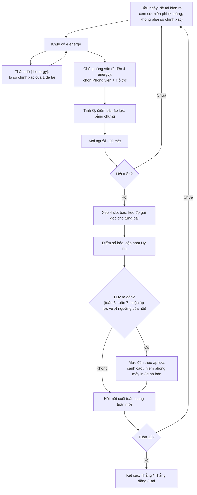

# TÀI LIỆU THIẾT KẾ CƠ CHẾ v2: GAME CLB BÁO CHÍ

> **Phiên bản:** v2, thay thế `Drafts.md`. Mọi con số trong tài liệu này đã được chạy thử bằng `sim_v2.py` (cùng thư mục), là bản tham chiếu chạy được của đúng bộ luật dưới đây.
> **Cách đọc nhãn:** **[Đã kiểm chứng]** = có số liệu mô phỏng ở mục 4 · **[Đặt tạm]** = con số mình chọn, chưa có dữ liệu chơi thật · **[Cần chốt]** = quyết định thuộc về bạn (cốt truyện, phạm vi, engine).

---

## MỤC LỤC
0. Vì sao có v2: lỗi của `Drafts.md` và cách sửa
1. Vòng lặp lõi
2. Luật chi tiết
3. Bảng tham số chuẩn
4. Kết quả mô phỏng
5. Dữ liệu 24 đề tài mẫu và quy tắc sinh nội dung tuần 4 đến 12
6. Đặc tả kỹ thuật (không phụ thuộc engine)
7. Việc còn bỏ ngỏ

---

## 0. Vì sao có v2

`Drafts.md` tự ghi là "khắc phục triệt để 100%". Không đúng. Mình đối chiếu công thức, dữ liệu và code, thấy các lỗi sau.

| # | Lỗi trong `Drafts.md` | Hệ quả | Cách sửa ở v2 |
|---|---|---|---|
| 1 | **Không có công thức điểm bài.** Q, Base Score, bản Đầy đủ/An toàn đều có, nhưng không chỗ nào nói chúng ghép với nhau thế nào | Không code được, và không ai kiểm được cân bằng | Mục 2.5: một công thức duy nhất |
| 2 | **Q kiểu tỉ lệ** `năng lực × (1+buff) / (độ khó + 2)`: độ khó 10 mà đội mạnh nhất, trang bị cao nhất cũng chỉ đạt 1,04. Đội trung bình (N=6) chỉ đạt 0,62 | Cuối game vẫn là tiến trình ngược, chỉ đỡ hơn bản đầu | Q cộng tính (mục 2.4): năng lực ngang độ khó thì Q ≈ 1 ở mọi giai đoạn |
| 3 | **Tin rác**: phạt "cắt 50% ngân sách" nhưng **không có ngân sách nào** trong luật hay trong `GameState` | Hình phạt không tồn tại | Bỏ khái niệm tin rác. Slot trống = 0 điểm và mất uy tín (mục 2.6, 2.7) |
| 4 | **Lỗ trong code tin rác**: chỉ phạt khi bài có cờ `isFillerJunk`, mà nộp 1 bài thì 2 slot trống không có cờ nào | Người chơi nộp thiếu bài mà không bị phạt, đúng exploit mà bản này nói đã vá | Tính theo số slot trống, không dựa vào cờ |
| 5 | **Điều kiện thắng không có thước đo.** "Bóc trần đường dây của Huy" nhưng không có chỉ số nào đo việc đó | Bad ending không thể kích hoạt đúng | Chỉ số Bằng chứng (mục 2.9) |
| 6 | **Mệt theo bậc thang** (cliff tại 30/60/90) ngay sau khi chê base score có cliff | Cùng lỗi, chuyển sang chỗ khác | Mệt tuyến tính (mục 2.3) |
| 7 | **5 energy/ngày + 3 slot báo**: tuần có 25 energy nhưng chỉ cần khoảng 10 cho 3 bài | Hơn một nửa energy thừa, nên energy không còn là ràng buộc | 4 energy/ngày, 4 slot, thêm hành động Thăm dò dùng đúng phần dư (mục 2.1, 2.2) |
| 8 | **Áp lực nền 40 sau mốc 100** chỉ cần thêm 60 là Huy ra đòn lần hai | Với người chơi cân bằng, áp lực chỉ hao hụt ít nên Huy có thể ra đòn nặng dồn dập (mình chưa đo chính xác trên luật gốc), mất vai trò cao trào | Áp lực hao hụt theo tuần, ngưỡng tăng theo từng hồi, giữ lại 30% sau đòn (mục 2.8): người chơi cân bằng chịu khoảng 3 đòn nặng |
| 9 | **Hạ bậc danh hiệu + cắt tiền** làm hình phạt cho một lỗi chỉ cần chọn lại bài | Phạt đánh vào nhãn chữ, không đánh vào tài nguyên | Hình phạt nằm ở uy tín và bằng chứng, cả hai quyết định kết cục |
| 10 | **Tên trường thật "Chu Văn An"** gắn với câu chuyện che giấu sai phạm, đồng thời bỏ tên Tĩnh Tâm bạn đặt | Rủi ro dùng tên trường thật trong cốt truyện bóc phốt | Dùng lại **Tĩnh Tâm** |
| 11 | **Tự mâu thuẫn**: Director cấm UI mới, nhưng bản này thêm dàn trang 3 ô, thanh trượt, popup khủng hoảng, cây nâng cấp | Phình phạm vi | Chỉ giữ 3 thứ UI rẻ (mục 6.3). Popup khủng hoảng và cây nâng cấp bị cắt khỏi v1 |
| 12 | **Giả định Kotlin/Compose** dù engine chưa rõ | Đặc tả kỹ thuật có thể vô dụng | Mục 6 viết không phụ thuộc engine |
| 13 | **Dữ liệu chỉ có 3 tuần** nhưng học kỳ 12 tuần | Chưa thể chơi thật | Mục 5: quy tắc sinh nội dung, ghi rõ còn thiếu khoảng 72 đề tài |

**Những ý của `Drafts.md` được giữ lại:** lịch Hồi 1, 2, 3; Giám thị đứng sau Huy (hợp lý hóa quyền lực của một học sinh); đồng hồ 12 tuần; bản Đầy đủ/An toàn là một lựa chọn có giá; suy ra phạt Vân từ lịch sử thay vì lưu cờ.

**Những thứ mình chủ động cắt khỏi v1:** RNG và popup "ép cung hay buông tay"; minigame dán truyền đơn ban đêm; nhánh hậu quả cho từng NPC; cây nâng cấp có tiền. Lý do: v1 xác định hoàn toàn (không save-scum được), và mọi cơ chế đều chạy được bằng một vài con số.

---

## 1. Vòng lặp lõi

Game đặt người chơi vào vai **Khuê**, trưởng đội phóng viên CLB báo chí trường THPT **Tĩnh Tâm**. Cùng Vân, Long, Nhi và các thành viên sau này, Khuê điều tra những mảng tối của trường để khôi phục Tập san. Phản diện là **Huy** (Chủ tịch Hội học sinh), được Thầy Giám thị (tên chưa đặt) đứng sau, che giấu sai phạm để đón đoàn thẩm định Trường Chuẩn.



**Hai thước đo quyết định kết cục.** *Bằng chứng* đo mức độ sự thật được phơi bày (cần mạch chính, gai góc, nhiều bài). *Uy tín* đo việc tờ báo còn đứng vững (cần bài chất lượng đều, đủ slot, né đòn nặng của Huy). Gai góc càng cao thì Bằng chứng càng nhanh nhưng Uy tín càng hao. Đó là sự giằng xé cốt lõi của game, và không có một lựa chọn nào thắng cả hai.

---

## 2. Luật chi tiết

### 2.1. Thời gian và Energy
- Học kỳ **12 tuần × 5 ngày**. Mỗi tuần ra một số báo vào cuối tuần. **[Cần chốt]**: nếu bạn muốn hai tuần một số thì phải mô phỏng lại.
- Khuê có **4 energy mỗi ngày, không dồn sang ngày sau**. Energy là *sự chú ý của người trưởng nhóm*, không phải sức lực cá nhân: Khuê không bị trừ mệt khi tiêu energy. Khuê chỉ mệt khi chính Khuê được giao phỏng vấn hoặc hỗ trợ.
- Chi phí phỏng vấn **2, 3 hoặc 4 energy** (theo từng đề tài, xem mục 5). **Thăm dò tốn 1 energy.**
- Energy tối thiểu để dùng được mọi đề tài là bằng chi phí lớn nhất. **Không hạ xuống 3** (đề tài chi phí 4 sẽ không bao giờ làm được: thắng 0% ở thử nghiệm). 5 energy cũng chạy được (88% thắng), nhưng 4 giữ cho ngày có cân nhắc: đề tài chi phí 4 chiếm trọn một ngày, chi phí 3 vừa đủ chỗ cho 1 Thăm dò, chi phí 2 đi đôi được.

### 2.2. Đối tượng, xem sơ và Thăm dò
- Mỗi tuần có **8 đề tài** xuất hiện rải rác trong tuần. Mỗi đề tài **sống 5 ngày** từ lúc xuất hiện rồi biến mất, kể cả khi người chơi chưa kịp làm. **[Đã kiểm chứng]**
- Mỗi đề tài có các thuộc tính thật: **Hấp dẫn** (1 đến 10), **Độ khó**, **Energy**, **Nhu cầu** (Ảnh / Tài liệu / Gan dạ / Hiểu chuyện), **Áp lực cơ sở**, **Mạch chính** (có/không).
- **Xem sơ miễn phí** chỉ hiện *khoảng*: Hấp dẫn dưới dạng khoảng ±1, Áp lực dưới dạng nhãn thấp/vừa/cao, kèm Loại, Nhu cầu, Energy, Hạn. Độ lệch của khoảng được cố định theo từng đề tài trong dữ liệu (không dùng ngẫu nhiên lúc chơi).
- **Thăm dò (1 energy)**: lộ số chính xác của Hấp dẫn và Áp lực cho một đề tài. Tác dụng đo được vừa phải (bỏ thăm dò: thắng từ 95% xuống 86%, bằng chứng 230 xuống 221). Nó không phải thứ ngăn người chơi tối ưu hóa, và không nên dựa vào nó để làm việc đó.

### 2.3. Nhân sự và Mệt
- Mỗi lần phỏng vấn chọn **một Phóng viên** và **một Người hỗ trợ** (hai người khác nhau). Mỗi người **tối đa 1 việc mỗi ngày**.
- Chỉ số mỗi nhân vật (1 đến 10): Phỏng vấn, Ảnh, Tài liệu, Gan dạ, Hiểu chuyện. Người hỗ trợ được tính theo chỉ số khớp với Nhu cầu của đề tài.
- **Mệt**: mỗi lần tham gia một việc (làm Phóng viên hoặc Hỗ trợ) **+20**. Mỗi đêm **−10**. Cuối tuần thêm **−30**. Trần 100.
- **Hiệu suất = 1 − 0,5 × Mệt / 100** (tuyến tính, không có bậc thang). Mệt 40 thì còn 80% hiệu suất, mệt 100 thì còn 50%.
- Nếu không có Người hỗ trợ khả dụng, Khuê tự làm phần hỗ trợ ở **50% chỉ số**. **[Đặt tạm]**
- **Thật thà về tác dụng của Mệt:** khi đã đủ 6 người, bỏ hẳn cơ chế mệt chỉ đổi thắng từ 95% lên 98%, tức là mệt gần như trang trí. Nó chỉ có sức nặng khi đội còn nhỏ (3 người: thắng 29%, mệt trung bình 24; 4 người: thắng 74%, mệt 18). Vậy Mệt thực chất là *thuế của đội nhỏ*, và sức nặng đó đến từ lịch người gia nhập (mục 7), không phải từ con số mệt.

### 2.4. Chất lượng Q và Trang bị
- **Năng lực nhóm N = 0,6 × (chỉ số Phỏng vấn của Phóng viên × hiệu suất) + 0,4 × (chỉ số khớp Nhu cầu của Hỗ trợ × hiệu suất)**
- **Q = giới hạn[ 1 + (N + T − (Độ khó + D) − 1) / 10 ] trong khoảng [0 ; 1,4]**
  - `T` = số mốc Trang bị đã mở (0 đến 3), mỗi mốc cộng 1 vào N.
  - `D` = độ khó cộng thêm do Huy (0 đến 2, xem 2.8).
- **Q dưới 0,6 thì phỏng vấn thất bại**: bài không có điểm, không có bằng chứng, không có áp lực. Energy và mệt vẫn mất.
- Ý nghĩa của Q: Q = 1 khi năng lực nhóm (có cả trang bị) ngang độ khó + 1. So với bản tỉ lệ của `Drafts.md` ở độ khó 10:

| Năng lực nhóm N | Q cũ (tỉ lệ, buff 25%) | Q mới (cộng tính, T = 3) |
|:---:|:---:|:---:|
| 6 | 0,62 | 0,80 |
| 8 | 0,83 | 1,00 |
| 10 | 1,04 | 1,20 |

- **Trang bị mở theo Uy tín, không có cửa hàng:** khi Uy tín cao nhất từng đạt chạm **42 / 55 / 68**, mở thêm một mốc (vĩnh viễn, không mất khi Uy tín tụt lại). Mốc đầu mở khoảng tuần 2, mốc hai khoảng tuần 4, mốc ba khoảng tuần 10 (có 68% lượt chơi đạt). Tên và hình thức của từng mốc (máy in sửa lại, máy ảnh, kho tài liệu...) là việc của bạn **[Cần chốt]**.
- **Trang bị là đòn bẩy lớn nhất của cả hệ thống.** Bỏ hẳn trang bị thì thắng 1%. Vì vậy 3 mốc trang bị phải được làm thành sự kiện cốt truyện rõ ràng, không phải phần thưởng ẩn.

### 2.5. Điểm bài và Độ gai góc
- Mỗi bài có một thanh trượt **gai góc g từ 0 (An toàn) đến 1 (Đầy đủ)**, liên tục, mặc định 0,5. Thay cho hai nút cứng.
- **Điểm bài = tối đa 100.000, tính bằng 100.000 × (Hấp dẫn / 10)² × Q × (0,85 + 0,30 × g)**
- **Áp lực bài = Áp lực cơ sở × (0,5 + g)**
- **Bằng chứng bài = 12 × Q × (0,5 + g)**, chỉ khi đề tài thuộc mạch chính.
- Đường cong Hấp dẫn dùng **bình phương**, không dùng 1,5 như `Drafts.md`. Lý do: với 1,5, bài đề tài bình thường quá dễ được điểm cao, nên số báo BANGER xuất hiện gần 3,6 lần mỗi 12 tuần ở người chơi cân bằng (so với 1,5 lần ở bình phương) và con đường chỉ-an-toàn lên được 57k điểm trung bình (so với 42k).

### 2.6. Số báo
- Mỗi tuần có **4 slot**: trang nhất và ba trang phụ. Chọn tối đa 4 bài đã phỏng vấn, xếp theo điểm giảm dần.
- **Điểm số báo = tối đa 100.000, tính bằng 0,80×a₁ + 0,25×a₂ + 0,12×a₃ + 0,08×a₄** (a₁ là bài điểm cao nhất).
- Slot trống (thiếu bài) tính 0 điểm, **không có hạng "tin rác", không hạ bậc, không cắt tiền**. Giao diện có thể điền một mẩu tin hài hước vào chỗ trống, chỉ để trang trí.
- **Phạt Vân vắng tòa soạn:** mỗi việc Vân tham gia trong tuần (làm phóng viên hoặc hỗ trợ) trừ **10%** điểm số báo, tối đa **25%**. Suy ra từ lịch sử bài của tuần, không lưu cờ.
  - Lý do giữ phạt: bỏ phạt thì dùng Vân bất chấp thắng 97%, giống hệt chiến thuật không dùng Vân. Với phạt 10%/việc, tụt còn 79%. Đủ để là một lựa chọn có giá chứ không phải một lệnh cấm.
  - Lời kể: Vân phụ trách in ấn và dàn trang, nên khi vắng báo ra muộn, mất thời điểm vàng phát hành.
- Khi Vân bị gán đi hiện trường, giao diện hiện một icon cảnh báo trên ô tòa soạn (UI rẻ, người chơi hiểu ngay).

**Thang nhãn số báo** (nhãn chỉ để hiển thị và phản ứng trong truyện, không đổi con số):

| Từ điểm | Nhãn | Ghi chú |
|---:|---|---|
| 0 | Chẳng ai quan tâm | Bạn chốt |
| 50 | Chưa thu hút | Bạn chốt |
| 500 | Lác đác bàn tán | Nhãn mình đặt, mốc của bạn |
| 5.000 | Được nhắc đến trong trường | Đặt tạm |
| 30.000 | Được quan tâm | Bạn chốt |
| 60.000 | Lan ra ngoài trường | Đặt tạm |
| 90.000 | BANGER | Bạn chốt |

Phân bố của người chơi cân bằng: Được quan tâm 31%, Lan ra ngoài trường 56%, BANGER 12,5% (khoảng 1,5 tuần mỗi kỳ). Nếu thấy "Lan ra ngoài trường" quá phổ biến, nâng mốc lên 70.000, chỉ ảnh hưởng nhãn.

### 2.7. Uy tín
- Uy tín từ 0 đến 100, **khởi đầu 30**.
- Mỗi tuần: **Uy tín ← 0,7 × Uy tín + 0,3 × (Điểm số báo / 1000) − 2 × (số slot trống)**, và trừ thêm 5 nếu cả 4 slot trống. Giới hạn 0 đến 100.
- Sau đó trừ phần phạt của đòn Huy (2.8).
- Là **trung bình trượt của chất lượng các số báo gần đây**, nên không cộng dồn vô hạn. Mình đã thử bản cộng dồn trước và nó rất nhạy: lệch 1 điểm mỗi tuần là lệch 12 điểm cuối kỳ, nên kết cục đảo từ 10% lên 100% chỉ vì đổi một hằng số.
- **Giải thể:** Uy tín bằng 0 trong **hai tuần liên tiếp** thì CLB bị giải tán sớm.

### 2.8. Huy, ba hồi và các mức đòn
- **Áp lực** cuối mỗi tuần: **Áp lực ← 0,85 × Áp lực + tổng áp lực các bài của tuần**.
- **Ba hồi** với ngưỡng áp lực khác nhau: Hồi 1 (tuần 1 đến 3) ngưỡng **100**; Hồi 2 (tuần 4 đến 7) ngưỡng **130**; Hồi 3 (tuần 8 đến 12) ngưỡng **160**.
- Huy ra đòn khi **hết tuần 3, hết tuần 7** (theo lịch, bất kể áp lực) **hoặc bất cứ lúc nào áp lực vượt ngưỡng của hồi** (đòn khẩn cấp).
- **Mức đòn:** đòn khẩn cấp luôn là mức 2. Đòn theo lịch: áp lực dưới 40% ngưỡng thì mức 0, dưới 80% thì mức 1, còn lại mức 2.

| Mức | Tên (lời kể) | Uy tín | Hiệu ứng |
|:---:|---|:---:|---|
| 0 | Cảnh cáo miệng | −3 | Không |
| 1 | Niêm phong máy in (Thầy Giám thị ký biên bản) | −6 | Độ khó **+1** từ nay (cộng dồn tối đa +2) |
| 2 | Đình bản | −10 | Độ khó **+1** (cộng dồn tối đa +2), **số báo tuần kế tiếp ×0,5** (phát hành lén) |

- Sau mỗi đòn, **áp lực giữ lại 30%** (không về 0, không giữ nền cố định 40 như `Drafts.md`).
- Đòn theo lịch **gần như không đổi con số** (bỏ lịch: thắng 89% so với 95%). Nó là nhịp truyện, không phải cân bằng. Giữ nó vì lý do kể chuyện, và vì nó đảm bảo Huy luôn hiện diện dù người chơi né áp lực.
- Con đường né Huy bằng cách chỉ làm tin an toàn **không thắng được** vì không đủ Bằng chứng (mục 2.9), chứ không phải vì áp lực ép.

### 2.9. Bằng chứng và kết cục
- **Bằng chứng** cộng dồn từ các bài mạch chính (công thức ở 2.5). **Cần 200** để thắng.
- Kết cục tuần 12:
  - **Thắng:** Bằng chứng ≥ 200 **và** Uy tín ≥ 55.
  - **Thắng đắng:** Bằng chứng ≥ 200 nhưng Uy tín < 55 (sự thật ra ánh sáng, nhưng tờ báo kiệt quệ).
  - **Bại:** Bằng chứng < 200 (trường nhận chuẩn giả).
  - **Giải thể** nếu Uy tín bằng 0 hai tuần liên tiếp.

---

## 3. Bảng tham số chuẩn

| Nhóm | Tham số | Giá trị | Trạng thái |
|---|---|---|---|
| Thời gian | Số tuần × ngày | 12 × 5 | Cần chốt (tuần/số báo) |
| Energy | Energy mỗi ngày | 4 | Đã kiểm chứng |
| | Chi phí phỏng vấn | 2 đến 4 | Dữ liệu từng đề tài |
| | Chi phí Thăm dò | 1 | Đặt tạm |
| | Số ngày một đề tài tồn tại | 5 | Bạn chốt (tạm tính) |
| Mệt | Mệt mỗi việc / mỗi đêm / cuối tuần | +20 / −10 / −30 | Đã kiểm chứng |
| | Hiệu suất | 1 − 0,5 × mệt/100 | Đã kiểm chứng |
| | Việc tối đa mỗi người mỗi ngày | 1 | Đặt tạm |
| Q | Trọng số Phóng viên / Hỗ trợ | 0,6 / 0,4 | Đặt tạm |
| | Q | 1 + (N + T − (khó + D) − 1)/10 | Đã kiểm chứng |
| | Trần Q / ngưỡng thất bại | 1,4 / 0,6 | Đặt tạm |
| | Hỗ trợ khi không có người | ×0,5 chỉ số của Khuê | Đặt tạm |
| Điểm | Điểm tối đa | 100.000 | Bạn chốt |
| | Số mũ Hấp dẫn | 2 | Đã kiểm chứng |
| | Hệ số điểm theo gai góc | 0,85 + 0,30 × g | Đặt tạm |
| | Hệ số áp lực theo gai góc | 0,5 + g | Đặt tạm |
| | Hệ số bằng chứng theo gai góc | 0,5 + g | Đặt tạm |
| Số báo | Số slot | 4 | Đã kiểm chứng |
| | Trọng số slot | 0,80 / 0,25 / 0,12 / 0,08 | Đã kiểm chứng |
| | Phạt Vân | 10% mỗi việc, tối đa 25% | Đã kiểm chứng |
| Uy tín | Khởi đầu / hệ số trượt | 30 / 0,3 | Đã kiểm chứng |
| | Phạt mỗi slot trống / cả báo trống | −2 / −5 | Đặt tạm |
| | Ngưỡng 3 mốc trang bị | 42 / 55 / 68 | Đã kiểm chứng |
| Huy | Hao hụt áp lực mỗi tuần | ×0,85 | Đã kiểm chứng |
| | Ngưỡng ra đòn Hồi 1 / 2 / 3 | 100 / 130 / 160 | Đã kiểm chứng |
| | Tuần ra đòn theo lịch | 3 và 7 | Cần chốt (cốt truyện) |
| | Áp lực giữ lại sau đòn | 30% | Đã kiểm chứng |
| | Phạt Uy tín đòn mức 0 / 1 / 2 | −3 / −6 / −10 | Đặt tạm |
| | Độ khó cộng thêm tối đa | +2 | Đặt tạm |
| | Số báo tuần sau đình bản | ×0,5 | Đặt tạm |
| Kết cục | Bằng chứng cần / Uy tín cần | 200 / 55 | Đã kiểm chứng |
| | Bằng chứng mỗi bài mạch chính | 12 × Q × (0,5 + g) | Đặt tạm |

---

## 4. Kết quả mô phỏng

**Cách mô phỏng:** `sim_v2.py`, 400 lượt mỗi chiến thuật, mỗi lượt là 60 ngày. Mỗi tuần có 8 đề tài, lấy lại mẫu từ 24 đề tài ở mục 5 (độ hấp dẫn dao động ±1 mỗi lượt). Đội nhập hội dần: Khuê, Vân, Long từ tuần 1; Nhi tuần 3; NV5 tuần 5; NV6 tuần 7 **[Cần chốt]**. Các chiến thuật là *heuristic máy*, không phải người chơi thật.

### 4.1. Tám chiến thuật

| Chiến thuật | Thắng | Thắng đắng | Bằng chứng | Uy tín | Điểm số báo TB | BANGER/kỳ | Đòn nặng |
|---|---:|---:|---:|---:|---:|---:|---:|
| **Cân bằng** (4 bài/tuần, thăm dò, né Vân, gai góc 0,2 đến 0,6 theo áp lực) | **95%** | 4% | 230 | 68 | 69k | 1,5 | 2,9 |
| Cân bằng nhưng dùng Vân bất chấp | 79% | 20% | 228 | 62 | 62k | 0,6 | 3,0 |
| Cân bằng, gai góc cố định 80% | 56% | 44% | 344 | 56 | 68k | 3,1 | 5,5 |
| Tham điểm, gai góc 100%, không thăm dò | 3% | 97% | 436 | 43 | 63k | 2,5 | 7,3 |
| Cày an toàn 5 tuần rồi bung | 2% | 0% | 166 | 70 | 62k | 2,2 | 1,6 |
| Khuê cày một mình | 0% | 0% | 114 | 23 | 46k | 0,0 | 2,0 |
| Ngủ đông (1 bài/tuần) | 0% | 0% | 99 | 26 | 49k | 0,0 | 0,0 |
| Chỉ an toàn (đề tài áp lực thấp, gai góc 0) | 0% | 0% | 0 | 42 | 42k | 0,0 | 0,0 |

**Đọc kết quả:**
- **Chỉ có một cách chơi thắng ổn định:** cân bằng. Mọi lối đi tắt đều thua, và thua *khác kiểu* nhau: tham điểm thì Bằng chứng dư nhưng Uy tín cạn (thắng đắng), chỉ an toàn thì Uy tín giữ được nhưng Bằng chứng 0 (bại), ngủ đông thì thiếu cả hai.
- **Độ gai góc là một dải trơn chứ không phải công tắc:** 0,5 thắng 95%, 0,8 thắng 56% (44% thắng đắng), 1,0 thắng 3% (97% thắng đắng).
- **Cày an toàn trước rồi bung** (meta Devil's Advocate nêu) không thống trị: chỉ thắng 2%, vì mạch chính hết hạn trong lúc đi cày và phần còn lại không đủ để bù.
- **Dùng Vân bất chấp** thua rõ so với né Vân (79% so với 95%), chứng minh phạt Vân có tác dụng.

### 4.2. Thử bỏ từng luật (người chơi cân bằng)

| Thử nghiệm | Thắng | Thắng đắng | Bằng chứng | Uy tín | Điểm số báo TB | BANGER/kỳ | Mệt TB |
|---|---:|---:|---:|---:|---:|---:|---:|
| **Cơ sở** | 95% | 4% | 230 | 68 | 69k | 1,5 | 14 |
| Đủ 6 người từ tuần 1 | 99% | 1% | 252 | 72 | 76k | 3,3 | 10 |
| Chỉ 4 người | 74% | 20% | 221 | 61 | 65k | 0,9 | 18 |
| Chỉ 3 người | 29% | 11% | 191 | 57 | 62k | 0,5 | 24 |
| Bỏ mệt | 98% | 2% | 241 | 71 | 72k | 2,1 | 14 |
| **Bỏ trang bị** | **1%** | 4% | 180 | 53 | 60k | 0,1 | 14 |
| Huy không theo lịch | 89% | 8% | 231 | 66 | 70k | 1,8 | 14 |
| Bỏ thăm dò | 86% | 5% | 221 | 67 | 68k | 1,4 | 14 |
| 3 slot (làm 3 bài/tuần) | 86% | 2% | 213 | 69 | 68k | 0,9 | 11 |
| Energy 5/ngày | 88% | 3% | 219 | 69 | 69k | 1,3 | 14 |
| Energy 3/ngày | 0% | 0% | 49 | 64 | 66k | 0,3 | 14 |
| Vân bất chấp, không phạt | 97% | 3% | 238 | 69 | 71k | 1,8 | 14 |
| Vân bất chấp, phạt 10%/việc (v2) | 79% | 20% | 228 | 62 | 62k | 0,6 | 14 |
| Vân bất chấp, phạt 15%/việc | 65% | 30% | 223 | 59 | 58k | 0,4 | 14 |
| Hấp dẫn^1,5 (bản `Drafts.md`) | 99% | 0% | 225 | 80 | 77k | 3,6 | 14 |
| Hấp dẫn^1,5, chỉ an toàn | 0% | 0% | 0 | 58 | 57k | 0,0 | 12 |
| Hấp dẫn^2 (v2), chỉ an toàn | 0% | 0% | 0 | 42 | 42k | 0,0 | 12 |

**Mình rút ra:**
1. **Trang bị quyết định cả game.** Không có trang bị thì không thể thắng. Hệ quả thiết kế: 3 mốc trang bị phải được làm thành thứ người chơi *thấy và chủ động hướng tới*.
2. **Đội ngũ là biến nhạy nhất.** 3 người: 29%, 4 người: 74%, 6 người: 99%. Lịch ai vào lúc nào quan trọng hơn mọi tinh chỉnh số.
3. **Mệt gần như trang trí khi đủ người.** Nó chỉ cắn khi đội nhỏ. Nếu bạn muốn mệt có sức nặng cả cuối game, phải tăng mệt mỗi việc hoặc giảm số người, và mình chưa kiểm chứng việc đó.
4. **Đòn theo lịch của Huy gần như không đổi số.** Nó là nhịp kể chuyện.
5. **Thăm dò chỉ có tác dụng vừa.** Không nên coi nó là cách chống người chơi tối ưu.
6. **3 hay 4 slot gần như tương đương** (86% so với 95%). Mình chọn 4 để dùng hết energy; nếu cần giảm giao diện thì 3 slot vẫn chạy được.
7. **Bản số mũ 1,5 cho BANGER 3,6 lần mỗi kỳ.** Quá nhiều, làm BANGER mất giá.

### 4.3. Một lượt chơi mẫu (người chơi cân bằng, lượt có bằng chứng gần trung vị)

| Tuần | Bài | Điểm số báo | Uy tín | Bằng chứng | Áp lực (trước đòn) | Đòn | Trang bị |
|:---:|:---:|---:|---:|---:|---:|:---:|:---:|
| 1 | 4 | 61.174 | 37 | 9 | 43 | | 0 |
| 2 | 4 | 69.562 | 47 | 28 | 80 | | 1 |
| 3 | 4 | 95.525 | 52 | 44 | 108 | **2** | 2 |
| 4 | 4 | 40.086 | 48 | 80 | 106 | | 2 |
| 5 | 4 | 76.254 | 57 | 96 | 121 | | 2 |
| 6 | 4 | 96.080 | 58 | 120 | 154 | **2** | 3 |
| 7 | 4 | 42.014 | 47 | 141 | 86 | **1** | 3 |
| 8 | 4 | 90.171 | 60 | 169 | 75 | | 3 |
| 9 | 4 | 71.491 | 64 | 186 | 97 | | 3 |
| 10 | 4 | 75.859 | 67 | 203 | 121 | | 3 |
| 11 | 4 | 75.712 | 70 | 220 | 135 | | 3 |
| 12 | 4 | 83.418 | 74 | 229 | 143 | | 3 |

Kết cục: **Thắng** (Bằng chứng 229, Uy tín 74). Có ba đòn của Huy (tuần 3, 6, 7), tuần 4 điểm tụt vì đình bản ×0,5 sau đòn tuần 3.

### 4.4. Ví dụ tính tay một lần phỏng vấn

Đề tài **S04 Hồ sơ Tập san thời ông Khuê** (Hấp dẫn 8, Độ khó 7, nhu cầu Tài liệu, Áp lực 18, mạch chính). Khuê phỏng vấn (Phỏng vấn 7, mệt 0), Nhi hỗ trợ (Tài liệu 9, mệt 0), đã mở 1 mốc trang bị, chưa có đòn Huy, gai góc 0,5.

- N = 0,6 × 7 + 0,4 × 9 = **7,8**
- Q = 1 + (7,8 + 1 − 7 − 1)/10 = **1,08**
- Điểm bài = 100.000 × 0,64 × 1,08 × (0,85 + 0,15) = **69.120**
- Áp lực = 18 × (0,5 + 0,5) = **18**
- Bằng chứng = 12 × 1,08 × 1,0 = **12,96**

Nếu Khuê đang mệt 40 (hiệu suất 0,8): N = 0,6 × 7 × 0,8 + 3,6 = 6,96 và Q = 0,996, điểm còn **63.700**.

---

## 5. Dữ liệu 24 đề tài mẫu và quy tắc sinh nội dung

**Điểm gốc** = 100.000 × (Hấp dẫn/10)², đã đổi theo số mũ mới. **Hạn** = ngày xuất hiện + 4. Ngày tính từ 1 đến 60 (tuần 1 là ngày 1 đến 5).

| Mã | Tên đối tượng | Xuất hiện | Hạn | Hấp dẫn | Điểm gốc | Khó | Energy | Nhu cầu | Áp lực | Mạch chính |
|:---:|---|:---:|:---:|:---:|---:|:---:|:---:|:---:|:---:|:---:|
| S01 | Bác bảo vệ cổng trường | 1 | 5 | 4 | 16.000 | 3 | 2 | Hiểu chuyện | 1 | |
| S02 | Căng tin tăng giá đột ngột | 1 | 5 | 6 | 36.000 | 4 | 3 | Tài liệu | 6 | |
| S03 | Phòng đọc cũ tầng 2 bị khóa | 1 | 5 | 5 | 25.000 | 5 | 3 | Ảnh | 5 | |
| S04 | Hồ sơ Tập san thời ông Khuê | 2 | 6 | 8 | 64.000 | 7 | 4 | Tài liệu | 18 | **Có** |
| S05 | Cô lao công lâu năm | 2 | 6 | 5 | 25.000 | 4 | 2 | Hiểu chuyện | 1 | |
| S06 | Đội bóng rổ thiếu sân tập | 3 | 7 | 6 | 36.000 | 5 | 3 | Ảnh | 4 | |
| S07 | Lớp 12A5 đồng loạt xin nghỉ | 3 | 7 | 7 | 49.000 | 6 | 3 | Gan dạ | 10 | |
| S08 | Cuộc họp kín của Hội học sinh | 4 | 8 | 9 | 81.000 | 8 | 4 | Gan dạ | 26 | **Có** |
| S09 | Thầy cựu cố vấn Tập san | 6 | 10 | 8 | 64.000 | 6 | 3 | Hiểu chuyện | 12 | **Có** |
| S10 | Mái nhà dãy A dột | 6 | 10 | 4 | 16.000 | 3 | 2 | Ảnh | 1 | |
| S11 | Học sinh giỏi bị ép dự thi | 6 | 10 | 7 | 49.000 | 6 | 3 | Hiểu chuyện | 10 | |
| S12 | Thùng góp ý ẩn danh | 7 | 11 | 5 | 25.000 | 4 | 2 | Tài liệu | 3 | |
| S13 | Quán nước cổng sau | 7 | 11 | 3 | 9.000 | 2 | 2 | Ảnh | 1 | |
| S14 | Chiến dịch dọn trường đón đoàn | 8 | 12 | 8 | 64.000 | 7 | 4 | Gan dạ | 22 | **Có** |
| S15 | Kho báo cũ của thủ thư | 9 | 13 | 6 | 36.000 | 4 | 3 | Tài liệu | 2 | |
| S16 | Học sinh chuyển trường giữa kỳ | 9 | 13 | 6 | 36.000 | 5 | 3 | Hiểu chuyện | 6 | |
| S17 | Danh sách thẩm định trường chuẩn | 11 | 15 | 9 | 81.000 | 8 | 4 | Tài liệu | 30 | **Có** |
| S18 | Bản tin chính thức của trường | 11 | 15 | 6 | 36.000 | 5 | 3 | Tài liệu | 6 | |
| S19 | Học sinh bị phạt vì quay clip | 11 | 15 | 7 | 49.000 | 6 | 3 | Gan dạ | 12 | |
| S20 | Phụ huynh phản ánh áp lực thi | 12 | 16 | 8 | 64.000 | 7 | 4 | Hiểu chuyện | 16 | **Có** |
| S21 | Cựu học sinh khóa ông Khuê | 12 | 16 | 9 | 81.000 | 7 | 4 | Hiểu chuyện | 22 | **Có** |
| S22 | Sân khấu văn nghệ xây vội | 13 | 17 | 5 | 25.000 | 3 | 2 | Ảnh | 3 | |
| S23 | Học sinh thức khuya ở thư viện | 13 | 17 | 6 | 36.000 | 4 | 2 | Ảnh | 1 | |
| S24 | Quỹ khuyến học đi đâu | 14 | 18 | 8 | 64.000 | 8 | 4 | Tài liệu | 28 | **Có** |

**Quy tắc sinh nội dung cho tuần 4 đến 12** (còn thiếu khoảng 72 đề tài **[Cần chốt]**, trong mô phỏng mình lặp lại mẫu trên):
- Mỗi tuần **8 đề tài**: khoảng **2 đến 3 mạch chính** (Hấp dẫn 7 đến 9, Áp lực 12 đến 30) và còn lại là tin phụ (Hấp dẫn 3 đến 6, Áp lực 1 đến 6).
- Độ khó ≈ Hấp dẫn − 1 (dao động ±1). Energy: khó ≤ 4 thì 2 (đôi khi 3), 5 đến 6 thì 3, ≥ 7 thì 4.
- Tổng bằng chứng mạch chính khả dụng trong cả kỳ nên đủ để người chơi cân bằng thắng khi bỏ lỡ khoảng một nửa số mạch chính (nên chốt khi viết nội dung thật).
- Tin phụ nên **mang manh mối** dẫn tới mạch chính (ví dụ S02 liên quan S24), dưới dạng *thẻ manh mối* để mở ra lựa chọn trong lời thoại, **không** làm giảm độ khó (tránh sắp đặt gượng ép).

---

## 6. Đặc tả kỹ thuật (không phụ thuộc engine)

### 6.1. Trạng thái trò chơi
```
GameState {
  week: 1..12,  day: 1..60,
  energy: int,                         // 4 đầu ngày
  fatigue: Map<CharId, 0..100>,
  joinWeek: Map<CharId, int>,          // dữ liệu tĩnh, ai vào tuần nào
  subjects: List<Subject>,             // trạng thái: AVAILABLE / SCOUTED / DONE / EXPIRED
  weekArticles: List<Article>,         // các bài đã chốt trong tuần
  reputation: float,   maxReputation: float,   // maxReputation quyết định mốc trang bị
  pressure: float,
  difficultyOffset: int (0..2),
  suspendedNextWeek: bool,
  evidence: float,
  zeroRepStreak: int
}
Article { subjectId, reporterId, supporterId, gaiGoc: float,
          q: float, score: float, pressure: float, evidence: float }
```
- **Suy ra, không lưu:** số mốc trang bị = số mốc trong (42, 55, 68) mà `maxReputation` đã chạm; số việc của Vân trong tuần = đếm trong `weekArticles` các bài mà Vân là phóng viên hoặc hỗ trợ. Không dùng cờ `isVanOut` (dễ lệch khi người chơi hủy thao tác).
- **Không có ngẫu nhiên trong v1.** Khoảng hiển thị của xem sơ nằm cố định trong dữ liệu từng đề tài, nên tắt mở game không đổi kết quả (không cần seed).

### 6.2. Hàm thuần chính
```
efficiency(m)              = 1 - 0.5 * m / 100
groupPower(pv, ht, subj)   = 0.6 * stat(pv,'PV')*eff(pv) + 0.4 * stat(ht, subj.need)*eff(ht)   // + T khi tính Q
quality(N, T, subj, D)     = clamp(1 + (N + T - (subj.khó + D) - 1)/10, 0, 1.4)
articleScore(subj, Q, g, R)= min(100000, 100000 * (subj.hấpDẫn/10)^2 * Q * (0.85 + 0.30*g))
closeWeek(state)           -> state', report      // xếp slot, tính số báo, cập nhật uy tín, áp lực, đòn Huy
```
Thứ tự trong `closeWeek`: (1) sắp bài, tính điểm số báo, áp phạt Vân và đình bản; (2) cập nhật Uy tín (kể cả phạt slot trống); (3) cộng bằng chứng và áp lực (áp lực hao hụt trước khi cộng); (4) kiểm tra đòn Huy, trừ Uy tín, tăng độ khó, đặt cờ đình bản, giữ lại 30% áp lực; (5) cập nhật chuỗi Uy tín bằng 0; (6) hồi mệt cuối tuần.

### 6.3. Giao diện tối thiểu cho v1
Chỉ ba thứ mới so với một game quản lý bình thường:
1. **Dàn trang 4 slot** (kéo bài vào ô, ô trống hiện mẩu tin hài hước, chỉ để trang trí).
2. **Thanh trượt gai góc** cho từng bài (hiện trước điểm, áp lực, bằng chứng dự kiến).
3. **Icon cảnh báo trên ô tòa soạn** khi Vân bị gán đi hiện trường.

### 6.4. Kiểm thử đối chiếu
- `sim_v2.py` là **bản tham chiếu**: cài đặt trong engine phải cho cùng kết quả với ví dụ tính tay ở 4.4 (S04: Q = 1,08; điểm 69.120; áp lực 18; bằng chứng 12,96) và với lượt chơi mẫu ở 4.3 khi chạy cùng chuỗi hành động.
- Nên viết bộ test đơn vị cho từng công thức ở 6.2 trước khi gắn giao diện.

---

## 7. Việc còn bỏ ngỏ

**Cần bạn chốt (cốt truyện / phạm vi / engine):**
1. **Lịch gia nhập của đội.** Mình đặt tạm Khuê, Vân, Long từ tuần 1; Nhi tuần 3; NV5 tuần 5; NV6 tuần 7. Đây là biến nhạy nhất của cân bằng (mục 4.2). Chốt ai vào lúc nào rồi mô phỏng lại.
2. **Tên Thầy Giám thị** và lý do trường dung túng Huy; Cô chủ nhiệm và Thầy cựu cố vấn có xuất hiện như một phần của Hồi 2 không.
3. **Nội dung tuần 4 đến 12** (khoảng 72 đề tài) và nội dung Hồi 3.
4. **Tên, hình thức của 3 mốc trang bị.**
5. **Số báo hằng tuần hay hai tuần một lần.**
6. **Engine và nền tảng.** Đặc tả ở mục 6 không phụ thuộc engine, nên chưa cần chốt ngay, nhưng cần trước khi viết code thật.

**Chưa mô phỏng, chưa kiểm chứng:**
- **Bond và hẹn hò**: file này không có. Gợi ý từ trước vẫn đứng: bond mở sở trường và hành động chủ động, hẹn hò cho phần thưởng cốt truyện chứ không phải thêm chỉ số.
- **Mệt chạm 100 thì ốm nghỉ một ngày** (ý trong `Drafts.md`): không có trong mô phỏng.
- **Tác động của chuỗi "tuần tồi"** ngoài các đòn của Huy (ví dụ nhiều tuần liền không đạt "Được quan tâm"): hiện chỉ có Uy tín xử lý.
- **Người chơi thật.** Mọi con số "thắng %" là của máy chơi heuristic tốt: người thật sẽ thắng ít hơn. Cần chơi thử để xem tỉ lệ thật và sửa tham số.

**Nguyên tắc khi sửa tiếp:** mỗi lần sửa một luật, chạy lại `python sim_v2.py` và đọc cả bảng 8 chiến thuật. Ở các vòng thử trước, mỗi bản vá một lỗ đều mở ra một lỗ khác ở chỗ khác; bảng chiến thuật là cách nhanh nhất để thấy điều đó trước khi nó vào game.