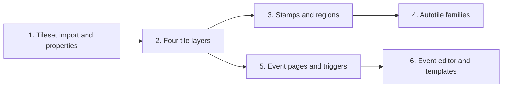

# World map authoring programme

Ngày lập: 2026-10-21. Mốc code đã khảo sát: `2185a55`.

## Mục tiêu và cách chia việc

Người làm nội dung có thể nhập tileset, xác định chỗ đi được/chặn đường/đi dưới,
vẽ map nhiều lớp và cấu hình tương tác ngay trong editor. Tiếp tục dùng object,
NPC, dialogue, draft, undo/redo, source writer và Playtest hiện có.

Yêu cầu đã biết: giao diện editor dùng tiếng Anh; game dùng locale hiện tại;
map và hành vi hiện có phải được bảo toàn. Giả định cho kế hoạch: học workflow
của RPG Maker MZ, không yêu cầu đọc nguyên project hoặc chạy plugin MZ.

Ba hướng đã cân nhắc:

| Hướng | Lợi ích | Chi phí / giới hạn |
| --- | --- | --- |
| Mở rộng editor hiện có — chọn | Giữ được pipeline, test và nội dung hiện tại; nghiệm thu từng mốc | Phải mở rộng schema và runtime có kiểm soát |
| Dùng một editor ngoài làm nguồn chính | Có sẵn nhiều công cụ vẽ | Cần thêm pipeline chuyển đổi và đồng bộ entity/event riêng |
| Tương thích toàn bộ MZ | Có thể dùng trực tiếp project và quy ước MZ | Vượt nhu cầu hiện tại; kéo theo autotile, interpreter, save và plugin semantics |

Chia thành ba tiểu dự án: nền tảng tileset/layer; công cụ vẽ nâng cao; event
authoring. Mỗi tiểu dự án phải cho ra phần mềm dùng được trước khi mở rộng tiếp.
Spec và plan chi tiết đầu tiên dành cho nền tảng; hai phần sau có thứ tự công việc,
đầu ra và cổng nghiệm thu bên dưới, rồi được cụ thể hóa theo API thực tế đã giao.

## Lộ trình và phụ thuộc

Vẽ nâng cao và event đều cần nền tảng, nhưng event đầu tiên không phải chờ
autotile. Thứ tự mặc định: 1 → 2 → 3 → 4 → 5 → 6; có thể giao event trước
autotile nếu ưu tiên lúc đó là làm nội dung tương tác.

| Mốc | Người dùng làm được gì | Điều kiện nghiệm thu |
| --- | --- | --- |
| 1. Tileset | Import PNG; chọn kích thước ô, margin/spacing; gán collision, hướng bị chặn và priority | Lưu, reload và Playtest dùng đúng ảnh/metadata; ID cũ không đổi |
| 2. Layers | Vẽ bốn lớp; ẩn/khóa/chọn lớp; xóa trang trí vẫn giữ nền | Wall vẫn chặn dưới canopy; renderer, đi bộ, pathfinding và overlay thống nhất |
| 3. Stamps/regions | Chọn một khối tile để vẽ; copy vùng map; tô region độc lập | Một gesture = một undo; region không sửa hình/collision |
| 4. Autotile | Vẽ họ terrain tự nối góc/cạnh; giữ biến thể thủ công | Sửa/xóa một ô cập nhật đúng hàng xóm và undo khôi phục toàn bộ |
| 5. Event runtime | NPC đổi page theo quest/day/phase; điểm chuyển map; manh mối chỉ nhận một lần | Save/load, quay lại map và hủy cutscene không nhân đôi tác dụng |
| 6. Event authoring | Tạo/sửa pages, conditions, triggers và commands bằng UI; dùng template | Tác giả tạo ba ví dụ bằng editor, không sửa runtime JS |

## Tiểu dự án A — Tileset và bốn layer

Đọc [thiết kế](superpowers/specs/2026-10-21-world-map-foundation-design.md) và
[kế hoạch thực thi](superpowers/plans/2026-10-21-world-map-foundation.md).

Đầu ra gồm atlas import, metadata editor, lưu asset/source, renderer nhiều atlas,
scene schema v2, layer editing, collision theo cạnh và kiểm chứng tương thích.
Import lần đầu là PNG lưới thường; importer MZ A1–A4 chưa thuộc mốc này.

Phải hoàn thành một vòng thực tế: import → cấu hình → vẽ → undo → lưu → reload
→ đi thử bằng phím và chuột. Chỉ có preview trong bộ nhớ chưa đủ nghiệm thu.

## Tiểu dự án B — Vẽ map nâng cao

Thứ tự công việc dự kiến:

1. Multi-tile palette selection và stamp, có anchor, preview và clipping ở mép.
   Map sampling ghi rõ copy một layer hay tất cả; mặc định một layer đang chọn.
2. Region plane riêng: `0` là không gán, `1–255` là vùng; tô/xóa/fill và overlay.
   Region không tự gây collision hoặc chạy event. Metadata đặt tên qua content.
3. Autotile family trong content: lưu ID loại terrain và quy tắc biến thể;
   bắt đầu bằng terrain lưới thường nối bốn phía. Quy tắc góc chéo và format MZ
   là phần mở rộng riêng, không trộn vào importer PNG đầu tiên.
4. Tính lại biến thể cho vùng bị sửa và hàng xóm trong cùng patch. Có thao tác
   giữ biến thể thủ công; fill lớn không tạo hàng nghìn history entries.

File dự kiến: mở rộng `TilePaint.js`, `TileMapEditor.js`, `WorldDocument.js`;
thêm `content/world/autotiles.json`, `src/shared/autotileRules.js` và validator
Python tương ứng trong tools. Regions mở rộng scene contract và builder.

Nghiệm thu bằng bờ cỏ/đất, góc đường, stamp ở bốn mép map, map 256×256, fill,
undo/redo, reload; không thay terrain logic của map gốc. Công cụ bóng và ellipse
được thêm sau nếu việc dựng cảnh cần chúng; không chặn các mốc kể trên.

Trước thực thi, viết spec/plan riêng chốt kiểu lưu region và autotile theo
scene v2 đã giao, tránh ấn định trước một schema v3 không cần thiết.

## Tiểu dự án C — Event authoring

Chia thành bốn phần giao được riêng:

1. **Page resolver thuần:** chọn page có thứ tự cao nhất thỏa tất cả điều kiện.
   Điều kiện ban đầu: quest status, day/phase và cờ riêng của event. Kết quả giải
   thích được page thắng/thua. Dùng state hiện có khi đã biểu diễn được điều kiện.
2. **Trigger và runner:** Action Button, Player Touch và Autorun cho nhu cầu
   trước mắt. Có foreground lock, wait/resume và hủy khi đổi map, thay session
   hoặc thoát Playtest. Event Touch thêm khi có NPC di chuyển; Parallel chỉ thêm
   cùng một trường hợp sử dụng cụ thể, có lifecycle và giới hạn thực thi.
3. **Commands có kiểu:** gọi dialogue graph hiện có, choices/branch, chuyển map,
   wait, đổi cờ event và gọi các gameplay action đã được cho phép. Runner không
   sửa thẳng state và không cho chèn JavaScript tùy ý. Nhánh thay đổi gameplay
   đi qua `GameSession`; validate command references từ content.
4. **Editor:** danh sách event, vị trí/visual/priority, pages, condition builder,
   trigger picker, command list và inspector giải thích active page. Template
   đầu tiên: NPC thoại, transfer point, manh mối một lần. Destination picker
   chọn map/ô đích; debug trace hiển thị trigger, page và bước đang chạy.

Giữ event definition ở `content/`, khác với trạng thái lần chơi. Cờ bền vững dùng
khóa scene/event ổn định. Thêm field lưu game phải có save schema/validator/
migration và test save cũ trước khi bật mặc định. Đổi ID event đã phát hành là
thao tác migration, không phải sửa tên hiển thị.

Tích hợp với object/NPC hiện có; mỗi instance chỉ có một nguồn xử lý tương tác.
Khi gắn event mới, tránh vừa chạy `kind` legacy vừa chạy command list. Portals
hiện có tiếp tục hoạt động; migration từng nội dung phải có kiểm chứng tương đương.

Nghiệm thu: NPC đổi thoại theo quest; cửa chuyển map đúng spawn; manh mối không
nhận hai lần sau reload/quay lại; cutscene không chạy lặp; wait/choice hủy sạch
khi đổi scene; save cũ vẫn nạp được. Mỗi chức năng được tạo bằng UI từ đầu.

Trước thực thi, viết spec/plan riêng chốt persistent state, action contracts,
cancellation và page/trigger semantics theo ba ví dụ nghiệm thu này.

## Quy tắc bàn giao

- Không viết lại framework engine, battle system, dialogue HUD hay menu.
- Không thay art/map gốc hoặc rebaseline chỉ để làm test xanh.
- Mỗi mốc có docs, test, native keyboard/pointer review và commit tập trung.
- Chạy architecture; với code gameplay/UI/world/content chạy browser rồi baselines.
- PNG import theo chính sách binary hiện tại: metadata/hash và hướng dẫn phục hồi
  có trong Git; ảnh cần được giữ trong asset pack được bàn giao cùng project.
- Thực thi native trong session là lựa chọn đề xuất vì các task nền tảng dùng
  chung schema, collision và writer; không cần chia agent để viết nhiều biến thể API.

Tham khảo: [research MZ](research/2026-10-21-rpg-maker-mz-mapping-events.md),
[kiến trúc](ARCHITECTURE.md), [workflow authoring](DATA-AUTHORING.md).
