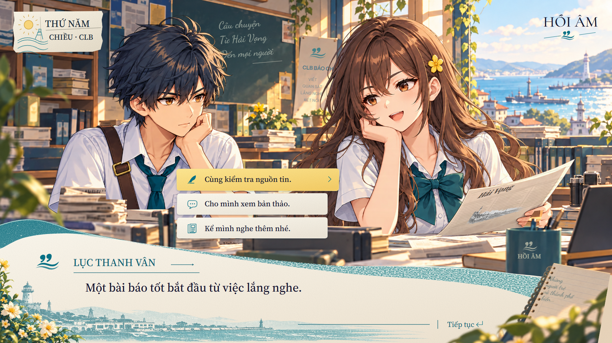

# Coastal replica — Stage 2 UI dialogue review

2026-10-09 · **scope revision 2: replica UI, context thay được**.
Bản dựng được commit ở `c21e732`; review full-scene trước đó không còn là tiêu
chí nghiệm thu hiện hành. [Roadmap](../../UI-REPLICA-ROADMAP.md) và
[UI scope](../../ui-specs/coastal-replica/ui-scope.json) quyết định việc tiếp tục.
**G2 UI chưa nghiệm thu**, không tự chuyển thành đạt sau khi bỏ scope background.

Preview: <http://127.0.0.1:8080/tools/coastal-replica-preview.html?version=2>.
Stage 1 vẫn mở bằng `?version=1`.

Stage 3 đã có UI-isolated views, local light/depth và conservative interior mask.
Đọc [review Stage 3](../coastal-replica-stage3/README.md) cho evidence/backlog mới;
các trạng thái chưa triển khai bên dưới mô tả mốc review Stage 2.

## Bản dựng đã có

Pack [v2](../../../assets/ui/coastal-replica/v2/README.md) có 19 asset / 29 instance
khai báo, **gồm cả UI và context**: 6 PNG sinh bằng imagegen builtin/reference edit,
13 SVG code-native. [Prompts](../../../assets/ui/coastal-replica/v2/prompts.json),
masters, pack Stage 1, concept PNG và baseline được giữ nguyên.

| Task | Đầu ra giữ lại | Việc tiếp tục theo scope mới |
| --- | --- | --- |
| R09 | Newsroom plate đang có | Dùng làm context; hoãn căn cảnh/bàn/cửa sổ 1:1 |
| R10 | Hai portrait alpha đang có | Dùng tùy chọn; hoãn sửa tóc/áo/tay/pose/identity |
| R11 | Hoa, notebook và foliage tách lớp | Chốt phần trang trí gắn UI, native alpha/crop/overlap/masks |
| R12 | Paper/wave/shore ink/harbor print, speaker/rules/body/continue | Chỉnh shape/material/print/type của thanh thoại |
| R13 | Choices/states/date/wordmark/marks | Chỉnh strips/icon/arrow/date/type; lưu logo dùng lại, thoại hiển thị tùy chọn |
| R14 | Native/full-frame diagnostics lịch sử | Thêm UI isolation/production masks và review UI theo từng component |

Chữ UI và decoration đã đi qua catalog. Chữ trên bảng/poster/cốc/báo cầm tay
thuộc context; có thể giữ cách render hiện có, không cần phục dựng microcopy
để qua G2 UI. Chữ trên **notebook trang trí thanh thoại** vẫn thuộc UI.
Đọc [fixture bổ sung](../../ui-specs/coastal-replica/dialogue-production.json)
như nguồn lịch sử, không nhập nó vào gameplay/runtime.

## Bằng chứng đã lưu và phạm vi sử dụng

- [Native v4](dialogue-native-v4.png), [capture contract](dialogue-native-v4.json),
  [overlay 50/50](dialogue-native-v4-overlay.png),
  [difference ×4](dialogue-native-v4-difference.png), [ROI report](dialogue-native-v4-comparison.json).
- [Contact sáng](material-light-v3.png), [contact tối](material-dark-v3.png),
  [sáu PNG masters](props-v3.png). Có crop mép 100%/50%.
- [Validation lịch sử](validation.json) ghi hashes, font coverage, suite và
  full-scene gate lúc capture; giữ nguyên nội dung để truy vết. Trạng thái mới
  nằm ở [status](../../ui-specs/coastal-replica/status.json).

Native viewport 1672×941, DPR 1, vi-VN/Asia-Bangkok, fixture clock/seed/static
settled; capture chờ fonts/decoded SVG assets. Chrome headless software chưa
nghiệm thu GPU hoặc realtime motion.

MAE RGBA v4 **16.5845**, Stage 1 **25.2556** là số đo **toàn ảnh theo scope cũ**,
không dùng chấm UI. V2 thấp hơn nhưng crop mất phố trong minh họa giấy; lỗi đó
thuộc UI, nên vẫn không chọn làm chuẩn. V3 sửa print, v4 nối phần giấy sổ bị cắt.
Giữ v1–v4/contact cũ; không coi chúng là UI-only captures đã làm.

## Backlog UI hiện hành

| Mức | Component | Việc cần sửa / bằng chứng cần có |
| --- | --- | --- |
| Chặn review | UI isolation/masks | Phân loại vùng đã có; còn mask pixel UI và capture UI độc lập. Bounding box hoa/sổ pha scene không đủ để chấm G2 |
| Lớn | Paper/wave/harbor print | Mép/silhouette, foam/grain quá đều, hình/độ đậm minh họa; native crops và UI-mask overlay |
| Lớn | Hoa/notebook/foliage gắn UI | Shape/crop khác reference, sổ có edge phục dựng; alpha trên nền sáng/tối, texture/bóng tiếp xúc ở phần nối |
| Lớn | Date/speaker/body/marks | Seal/icon stroke, type width/baseline/spacing; review glyph và bounds từng component |
| Cần review riêng | Choices/continue | Shape/texture/icon/arrow/state, copy alignment và targets; behavior tests không thay visual review |
| Tùy chọn | Logo thoại | Giữ mark/wordmark thành nguồn dùng lại; kiểm tra khi hiển thị, không chặn nếu ẩn |

**Loại khỏi backlog chặn UI:** tóc/áo/tay/pose Khuê/Vân, báo Vân cầm,
room/camera/bàn/ghế/cốc/cửa sổ, scene lettering và nắng scene. Các asset đó vẫn
là context dùng được, không cần sinh/căn tiếp cho stage UI.

G1 còn review native edge cho **UI art**. Tiếp theo R11–R14 rồi R15–R17
light/depth UI; không có dependency production portrait/background. G2 UI trước
motion R18–R23. Layer isolation hiện có phục vụ inspection; chưa thay thế gallery
UI đầy đủ hoặc masked comparison cần bổ sung ở R14.

## Kiểm chứng đã chạy ở commit Stage 2

Main 72/72; Stage 2 14/14; Stage 1 12/12; reference tools 13/13.
Architecture 0 issue / 780 text entries; 8 sandbox + 4 gameplay policies khớp
baseline. Builders, source lock, Python compile và whitespace check qua.

Suite kiểm tra resources/hash, live copy/fonts, paper anchors, mask ID isolation,
pointer input, scale, focus/callbacks, capture reset/lock và disposal. Các test
portrait uniform scale vẫn là regression của context hiện có, không chứng nhận
hay bắt buộc pose đúng concept. Chưa chạy kiểm thử UI-mask comparison vì đầu ra
đó chưa được triển khai. Đợt revision này chỉ sửa plan/docs.
