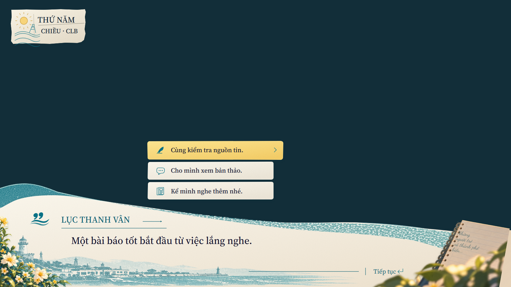

# Coastal replica — Stage 3: ánh sáng và chiều sâu UI

2026-10-09 · scope revision 2 · R15/R16 triển khai; R17 có evidence review.
**G2 visual vẫn mở**: các sai khác UI bên dưới cần đóng trước motion Stage 4.

Mở [preview tĩnh](http://127.0.0.1:8080/tools/coastal-replica-preview.html?version=3).
Chọn nền sáng/tối/có chi tiết/cảnh hiện có; bật/tắt ánh sáng để đối chiếu và bật
logo tùy chọn. Stage 1/2 vẫn ở `?version=1` / `?version=2`.

[Stage 4](../coastal-replica-stage4/README.md) bổ sung motion authoring trên art
v3 theo yêu cầu tiếp tục; backlog G2 bên dưới vẫn áp dụng, chưa tự nghiệm thu.

## Đã triển khai

| Task | Kết quả |
| --- | --- |
| R15 | Bóng tiếp xúc riêng cho paper/choice/date/hoa/notebook; wash giấy và notebook, highlight mép giấy; palette/grain/foam hiệu chỉnh ở source |
| R16 | Clip minh họa/wash theo paper, alpha mask cho notebook wash, một shadow cho edge + notebook PNG; chữ không qua filter; art không chặn input |
| R17 | Native captures trên bốn nền, A/B ánh sáng, logo, contact/crops sáng-tối; hash manifest/reference/mask, UI overlay/diff và kiểm tra regression |

[Pack v3](../../../assets/ui/coastal-replica/v3/README.md) có **14 UI asset**,
11 SVG + 3 PNG kế thừa native bytes. Hoa/notebook/bờ kè thuộc UI; context là slot
riêng. Không cần thêm background/portrait để review stage này.
Source: [composition](../../../content/ui/coastal-dialogue-ui.json),
[materials](../../../assets/ui/coastal-replica/v3/masters/materials.json),
[compositor](../../../src/ui/replica/DialogueUiComposition.js).
Chữ qua catalog; thông số lighting qua content. Gameplay chưa tích hợp preview này.

## Evidence hiện hành

- [Nền tối](ui-dark-v2.png), [nền sáng](ui-light-v1.png),
  [nền có chi tiết](ui-detail-v1.png), [context scene](ui-scene-v2.png).
- [Ánh sáng tắt, cùng nền tối](ui-flat-v1.png), [logo hiển thị](ui-logo-v1.png).
- [Contact sáng](material-light-v1.png), [contact tối + crop 100%/50%](material-dark-v1.png).
- [UI overlay](ui-dark-v2-ui-overlay.png), [UI difference ×4](ui-dark-v2-ui-difference.png),
  [UI report](ui-dark-v2-ui-comparison.json), [A/B và đổi nền](presentation-comparison.json).
- [Validation](validation.json), [main](main-browser.log), [Stage 3](stage3-browser.log),
  [Stage 2](stage2-browser.log), [Stage 1](stage1-browser.log), [reference tools](reference-browser.log).

Viewport 1672×941, DPR 1, vi-VN/Asia-Bangkok, fixture clock/seed 0/static,
chờ fonts và decode toàn bộ SVG/PNG. Chrome headless software; không phải
bằng chứng chất lượng animation hoặc GPU trên thiết bị thật.

Mask chọn **444.143 pixel / 28,229% frame**. Chỉ đo vùng bên trong card/choice/
wave/paper/notebook có độ chắc chắn cao; fringe hoa/sổ bị khuất, logo và context
không thuộc score. MAE RGBA nền tối **18,0943**, mang ý nghĩa diagnostic riêng;
không so với MAE toàn frame của Stage 1/2, không coi là chứng nhận 1:1.
Ngoài mask, overlay/diff trong suốt. Alpha-only errors cũng hiện trong diff.

A/B ánh sáng đổi 280.922 pixel, MAE toàn frame 0,1581: hiệu ứng nhẹ, tránh làm
bẩn chữ. Đổi nền giữ nguyên UI markup/geometry; trong mask vẫn có 402–481 pixel
khác rất nhỏ (MAE ≤0,00118) do alpha/antialias ở biên. Vì vậy đây là mask interior
bảo thủ, **không phải alpha trích xuất hoàn chỉnh**. Đọc dữ liệu từ pixel native,
không sửa/resize raster hoặc tạo score bằng bounding box toàn hoa/sổ.

`ui-dark-v1` là thử nghiệm grain shore quá loang đã bỏ. `ui-scene-v1` trước
notebook alpha wash. Giữ chúng làm lịch sử; dùng các phiên bản hiện hành ở trên.

## G2 — những gì còn cần tinh chỉnh

| Component | Sai khác còn thấy khi đối chiếu concept |
| --- | --- |
| Paper/wave | Silhouette đã giữ native anchors; foam/shore ink còn đều và dải trắng còn dày, thiếu vài nét mực vỡ và chim; cần native edge review |
| Date/choice/icons | Card đã có torn edge nhưng seal/wave/lighthouse vẫn đơn giản; choice corners và icon stroke còn khác reference |
| Typography | Font live chưa đúng toàn bộ glyph/width/baseline trong concept; copy trên overlay còn bị lệch/nhân nét ở một số dòng |
| Harbor/flowers/notebook | Minh họa bờ kè và alpha PNG tái dựng chưa đúng từng nét; cần sửa shape/overlap/texture ở các vùng UI, nhất là mép sổ và fringe hoa |
| Logo tùy chọn | Đã lưu mark và wordmark live; review riêng khi dùng |
| Review coverage | Interior mask đã có; vùng fringe/mixed bị khuất chưa có reference alpha đáng tin cậy để tự động chấm |

Đây là backlog UI, không có camera, pose, tóc/áo nhân vật hay scene sunlight làm
blocker. R17 có review package hoàn chỉnh nhưng **chưa đóng G2 acceptance**.
Tiếp theo tinh chỉnh các component còn lệch và review UI tĩnh, rồi R18–R23 làm
motion từng lớp theo [roadmap](../../UI-REPLICA-ROADMAP.md).

## Kiểm chứng

Main **72/72**; Stage 3 **17/17**; Stage 2 **14/14**; Stage 1 **12/12**;
reference tools **13/13**. Architecture **0 issue / 789 text entries**.
8 sandbox + 4 gameplay policies khớp baseline; builders v1/v2/v3 và source lock
qua. Test phủ local filter/mask IDs, notebook union, đổi nền/lighting/optional logo,
live fonts/bounds, scaled click/keyboard/focus, invalid capture trước mutation,
capture reset/lock/disposal và masked comparison bỏ context/hiện alpha error.
Các test chứng minh hành vi và pipeline, không thay thế visual review.
