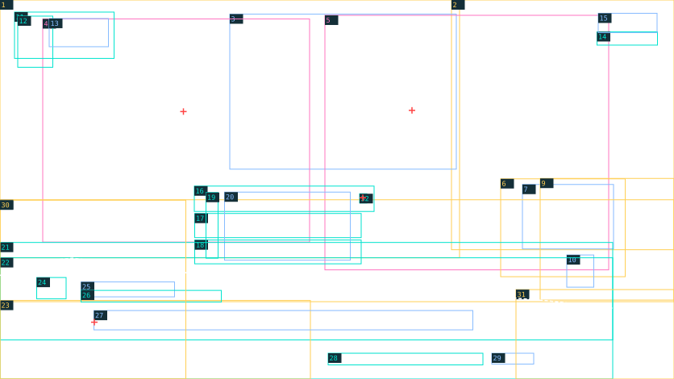

# Thoại — layout sheet

> Generated by tools/coastal_reference_specs.py; edit layouts.json / fixtures.json.



1672 × 941; x/y from top-left; bounding envelopes ±4 px for rectangular regions, ±12 px for organic silhouettes. These are placement seeds; final masks and type matching remain production work.

Yellow: reconstruct · cyan: vector/mask · pink: new pose · blue: text · red cross: anchor · white dashed: sampled contour.

| # | ID / role | x, y, w, h | z | Method | Asset / planned text group | Occlusion / production note |
| --- | --- | --- | --- | --- | --- | --- |
| 1 | room / Tòa soạn, kệ và bảng phía xa | 0, 0, 1140, 640 | 10 | reconstruct | dialogue.room | Xóa chữ khỏi plate; bổ sung cảnh sau hai nhân vật. |
| 2 | harbor / Cửa sổ, cảng và núi xa | 1120, 0, 552, 620 | 11 | reconstruct | dialogue.harbor | Giữ khung cửa và màu trời; không đổi camera. |
| 3 | wall-lettering / Chữ bảng, poster và tên CLB | 570, 35, 562, 385 | 12 | text | dialogue.scene-signs | Các cụm chữ nghiêng theo bề mặt cảnh. |
| 4 | khue / Khuê ngồi chống tay, satchel/tie | 106, 47, 662, 554 | 30 | new-pose | dialogue.khue | Phần thân và bàn bị choice/foreground che; không dùng portrait đứng. |
| 5 | van / Vân ngồi chống tay, cầm báo | 806, 38, 704, 632 | 31 | new-pose | dialogue.van | Tách tóc, mắt, tay và báo cho motion sau; giữ pose master. |
| 6 | held-newspaper / Tờ báo trong tay Vân | 1242, 444, 309, 243 | 32 | reconstruct | dialogue.held-newspaper | Quan hệ tay/báo cần mask riêng; giấy không chứa chữ bake. |
| 7 | held-news-text / Nội dung/tên báo cầm tay | 1296, 458, 226, 160 | 33 | text | dialogue.newspaper | Nghiêng theo tờ báo; ghi riêng chữ nhỏ cần xác minh. |
| 8 | desk / Bàn, đống báo và props trung cảnh | 0, 496, 1672, 253 | 40 | reconstruct | dialogue.desk | Không gộp giấy thoại hoặc nhân vật vào plate. |
| 9 | desk-cup / Cốc bút và laptop phía phải | 1340, 443, 332, 302 | 41 | reconstruct | dialogue.desk-cup | Cốc/bút là occluder trước tờ báo; laptop crop theo mép phải. |
| 10 | cup-mark / Biểu tượng và chữ trên cốc | 1406, 633, 67, 80 | 42 | text | dialogue.cup | Mark vector và chữ catalog riêng. |
| 11 | date-paper / Giấy date seal | 36, 30, 247, 115 | 60 | vector-mask | dialogue.date-paper | Mép rách và grain phải bám ref. |
| 12 | date-ornament / Mặt trời và tem sóng | 44, 40, 87, 127 | 61 | vector-mask | dialogue.date-ornament | Có vùng tem vượt ra khỏi giấy. |
| 13 | date-text / Ngày và buổi | 122, 46, 147, 70 | 62 | text | dialogue.date | Hai baseline; chữ serif đậm. |
| 14 | brand-mark / Mark sóng-trích dẫn góc phải | 1481, 79, 150, 33 | 61 | vector-mask | shared.brand-mark | Giữ silhouette và hai đường kẻ. |
| 15 | brand-text / HỒI ÂM góc phải | 1484, 33, 146, 48 | 62 | text | dialogue.brand | Tên thương hiệu là lớp chữ. |
| 16 | choice-verify / Dải lựa chọn vàng | 482, 462, 446, 63 | 65 | vector-mask | dialogue.choice-verify | Có grain, mép mềm; hit area cố định. |
| 17 | choice-draft / Dải lựa chọn giấy thứ hai | 483, 530, 413, 60 | 65 | vector-mask | dialogue.choice-draft | Không đổi thành button viền vuông. |
| 18 | choice-listen / Dải lựa chọn giấy thứ ba | 483, 596, 413, 59 | 65 | vector-mask | dialogue.choice-listen |  |
| 19 | choice-icons / Icon bút, thoại, tư liệu và chevron | 511, 478, 30, 163 | 66 | vector-mask | dialogue.choice-icons | Ba icon riêng; chevron active ở x=900. |
| 20 | choice-copy / Ba dòng lựa chọn | 557, 477, 312, 169 | 67 | text | dialogue.choices | Xếp dọc; baseline tương ứng 500,565,630. |
| 21 | dialogue-wave / Dải mực/sóng sau mép giấy | 0, 602, 1520, 242 | 70 | vector-mask | dialogue.dialogue-wave | Đường cong bất đối xứng và texture; không sóng sin trơn. |
| 22 | dialogue-paper / Giấy thoại toàn đáy | 0, 640, 1520, 301 | 71 | vector-mask | dialogue.dialogue-paper | Mép top theo contour; bề mặt chữ không chuyển động. |
| 23 | paper-harbor / Minh họa cảng dưới giấy | 0, 746, 770, 195 | 72 | reconstruct | dialogue.paper-harbor | Dạng in cyan, không phải cảnh background thu nhỏ. |
| 24 | speaker-mark / Mark speaker và ornament | 91, 689, 73, 53 | 73 | vector-mask | shared.brand-mark | Mark có variant/crop riêng cho speaker. |
| 25 | speaker-name / Tên speaker | 201, 700, 232, 37 | 74 | text | dialogue.speaker | Uppercase teal. |
| 26 | speaker-rules / Đường kẻ và mũi tên speaker | 201, 721, 348, 29 | 73 | vector-mask | dialogue.speaker-rules |  |
| 27 | dialogue-line / Vùng lời thoại | 233, 771, 940, 48 | 74 | text | dialogue.line | Baseline khoảng 800; serif, một dòng trong fixture. |
| 28 | continue-rules / Đường kẻ và phân cách tiếp tục | 814, 877, 384, 29 | 73 | vector-mask | dialogue.continue-rules |  |
| 29 | continue-copy / Tiếp tục và enter glyph | 1220, 877, 104, 27 | 74 | text | dialogue.continue | Glyph phím là thành phần locale/icon riêng. |
| 30 | foreground-left / Hoa, lá và báo mờ góc trái | 0, 497, 461, 444 | 90 | reconstruct | dialogue.foreground-left | Mask lên giấy; foreground không che lời thoại. |
| 31 | foreground-right / Sổ, cây/hoa mờ góc phải | 1280, 719, 392, 222 | 91 | reconstruct | dialogue.foreground-right | Occlude giấy và mép phải; không che continue. |
| 32 | choice-chevron / Chevron active | 892, 481, 18, 23 | 66 | vector-mask | dialogue.choice-chevron |  |

## Anchors and contours

```json
{
  "anchors": [
    {
      "id": "khue-eye",
      "point": [
        455,
        277
      ]
    },
    {
      "id": "van-eye",
      "point": [
        1022,
        274
      ],
      "note": "Left visible iris in screen coordinates; manual placement seed"
    },
    {
      "id": "choice-active-chevron",
      "point": [
        900,
        491
      ]
    },
    {
      "id": "dialogue-baseline",
      "point": [
        234,
        800
      ]
    }
  ],
  "contours": [
    {
      "id": "paper-top",
      "layer": "dialogue-paper",
      "kind": "visible-sampled-polyline",
      "points": [
        [
          0,
          684
        ],
        [
          70,
          651
        ],
        [
          180,
          641
        ],
        [
          330,
          659
        ],
        [
          510,
          684
        ],
        [
          730,
          714
        ],
        [
          945,
          731
        ],
        [
          1160,
          730
        ],
        [
          1360,
          747
        ],
        [
          1520,
          765
        ]
      ],
      "note": "Mẫu đường biên nhìn thấy; vùng 1520–1672 bị foreground che, không suy ra alpha."
    }
  ]
}
```

## Lighting / protected reading zones

```json
{
  "key": "warm daylight from harbor/right window",
  "rim": "hair shoulders and paper edges",
  "shadows": "contact at hands/newspaper/desk",
  "focus": "faces and choice strips",
  "protected": [
    "dialogue-line",
    "choice-copy"
  ]
}
```

## Typography and fixture text

Font sizes are estimates. Typeface, weight, exact baseline, kerning and rotation require R07 native-scale review. Planned keys belong to this authoring fixture until adopted by the live catalog.

| Group | Planned key | Text | Role / estimated px | Transcription status |
| --- | --- | --- | --- | --- |
| dialogue.scene-signs | ui.replica.dialogue.scene_signs.1 | Câu chuyện<br>Từ Hải Vọng<br>Đến mọi người | handwriting / 25 | transcribed-visible |
| dialogue.scene-signs | ui.replica.dialogue.scene_signs.2 | CLB BÁO CHÍ | handwriting / 25 | transcribed-visible |
| dialogue.scene-signs | ui.replica.dialogue.scene_signs.3 | Viết<br>Quan sát<br>Lắng nghe<br>Kết nối | handwriting / 25 | transcribed-visible |
| dialogue.newspaper | ui.replica.dialogue.newspaper.1 | Hải Vọng | editorial-serif / 23 | headline-transcribed-microcopy-pending |
| dialogue.cup | ui.replica.dialogue.cup.1 | HỒI ÂM | editorial-serif / 18 | transcribed-visible |
| dialogue.date | ui.replica.dialogue.date.1 | THỨ NĂM | editorial-serif / 27 | transcribed-visible |
| dialogue.date | ui.replica.dialogue.date.2 | CHIỀU · CLB | editorial-serif / 27 | transcribed-visible |
| dialogue.brand | ui.replica.dialogue.brand.1 | HỒI ÂM | editorial-serif / 42 | transcribed-visible |
| dialogue.choices | ui.replica.dialogue.choices.1 | Cùng kiểm tra nguồn tin. | editorial-serif / 25 | transcribed-visible |
| dialogue.choices | ui.replica.dialogue.choices.2 | Cho mình xem bản thảo. | editorial-serif / 25 | transcribed-visible |
| dialogue.choices | ui.replica.dialogue.choices.3 | Kể mình nghe thêm nhé. | editorial-serif / 25 | transcribed-visible |
| dialogue.speaker | ui.replica.dialogue.speaker.1 | LỤC THANH VÂN | editorial-serif / 29 | transcribed-visible |
| dialogue.line | ui.replica.dialogue.line.1 | Một bài báo tốt bắt đầu từ việc lắng nghe. | editorial-serif / 34 | transcribed-visible |
| dialogue.continue | ui.replica.dialogue.continue.1 | Tiếp tục | editorial-serif / 22 | transcribed-visible |
| dialogue.continue | ui.replica.dialogue.continue.2 | ↵ | editorial-serif / 22 | transcribed-visible |

Chữ lớn được chép trong fixtures; chữ nhỏ cảnh nằm ở nhóm transcription chưa canonical.
Speaker-mark dùng brand mark chung nhưng transform theo vùng riêng.
