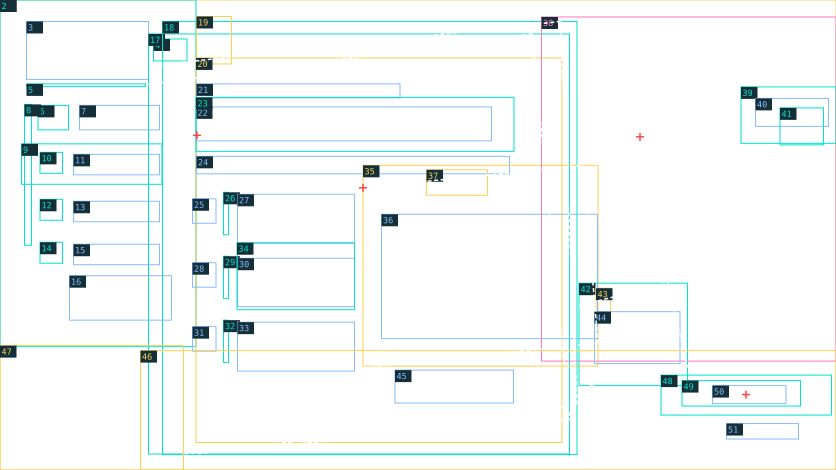

# Hồ sơ — layout sheet

> Generated by tools/coastal_reference_specs.py; edit layouts.json / fixtures.json.



1672 × 941; x/y from top-left; bounding envelopes ±4 px for rectangular regions, ±12 px for organic silhouettes. These are placement seeds; final masks and type matching remain production work.

Yellow: reconstruct · cyan: vector/mask · pink: new pose · blue: text · red cross: anchor · white dashed: sampled contour.

| # | ID / role | x, y, w, h | z | Method | Asset / planned text group | Occlusion / production note |
| --- | --- | --- | --- | --- | --- | --- |
| 1 | room-harbor / Tòa soạn/cảng, cửa sổ và cây | 0, 0, 1672, 941 | 10 | reconstruct | dossier.room-harbor | Phục dựng dưới folio/actor; camera riêng. |
| 2 | teal-nav / Mảng mực xanh bên trái | 0, 0, 392, 694 | 20 | vector-mask | dossier.teal-nav | Mép hữu cơ có grain, không sidebar card. |
| 3 | brand-copy / HỒI ÂM và tuần | 53, 43, 244, 116 | 25 | text | dossier.brand | Hai nhóm chữ. |
| 4 | brand-mark / Mark thương hiệu | 307, 78, 67, 44 | 24 | vector-mask | shared.brand-mark | Biến thể mark. |
| 5 | brand-rule / Rule thương hiệu | 53, 168, 238, 5 | 24 | vector-mask | dossier.brand-rule |  |
| 6 | section-icon / Mark section hồ sơ | 76, 211, 61, 49 | 25 | vector-mask | dossier.section-icon |  |
| 7 | section-copy / HỒ SƠ | 159, 211, 160, 49 | 26 | text | dossier.section | Large uppercase. |
| 8 | nav-spine / Trục/chấm sidebar | 49, 209, 14, 282 | 27 | vector-mask | dossier.nav-spine |  |
| 9 | nav-highlight / Vệt vàng Tổng quan | 43, 288, 281, 81 | 28 | vector-mask | dossier.nav-highlight |  |
| 10 | nav-overview-icon / Tổng quan: icon | 80, 305, 45, 42 | 29 | vector-mask | dossier.nav-overview-icon |  |
| 11 | nav-overview-copy / Tổng quan: chữ | 147, 309, 172, 41 | 30 | text | dossier.nav-overview | Upper/lower theo ref. |
| 12 | nav-sources-icon / Nguồn tin: icon | 80, 399, 45, 42 | 29 | vector-mask | dossier.nav-sources-icon |  |
| 13 | nav-sources-copy / Nguồn tin: chữ | 147, 403, 172, 41 | 30 | text | dossier.nav-sources | Upper/lower theo ref. |
| 14 | nav-draft-icon / Bản thảo: icon | 80, 485, 45, 42 | 29 | vector-mask | dossier.nav-draft-icon |  |
| 15 | nav-draft-copy / Bản thảo: chữ | 147, 489, 172, 41 | 30 | text | dossier.nav-draft | Upper/lower theo ref. |
| 16 | side-quote / Lời viết tay dưới navigation | 139, 552, 204, 89 | 30 | text | dossier.side-quote | Ba dòng nghiêng. |
| 17 | folio-under / Các tờ giấy phía sau | 297, 68, 842, 841 | 35 | vector-mask | dossier.folio-under | Giữ số lớp và shadows riêng. |
| 18 | folio-main / Mặt giấy hồ sơ | 325, 43, 829, 867 | 36 | vector-mask | dossier.folio-main | Quad nghiêng; plane text phẳng đúng góc. |
| 19 | folio-clamp / Kẹp kim loại trên giấy | 393, 33, 70, 95 | 37 | reconstruct | dossier.folio-clamp | Highlights kim loại và shadow chạm giấy; tách để motion. |
| 20 | folio-ornaments / Tem, harbour print và mark title | 392, 116, 732, 770 | 37 | reconstruct | dossier.folio-ornaments | Nhiều cụm không liên tục; không texture chữ. |
| 21 | folio-eyebrow / Hồ sơ 01 · Đang xác minh | 393, 168, 407, 28 | 40 | text | dossier.eyebrow | Tracking rộng. |
| 22 | folio-heading / Khoản thu câu lạc bộ | 392, 214, 591, 68 | 40 | text | dossier.heading | Điểm nhìn chính, serif bold. |
| 23 | folio-rules / Kẻ dưới eyebrow và heading | 392, 195, 636, 108 | 39 | vector-mask | dossier.folio-rules |  |
| 24 | folio-subtitle / Làm rõ khoản thu... | 393, 313, 626, 35 | 40 | text | dossier.subtitle | Một dòng. |
| 25 | step-one-number / one: số | 385, 398, 47, 49 | 40 | text | dossier.step-one-number | Italic cyan. |
| 26 | step-one-rule / one: trục/chấm | 447, 385, 10, 85 | 39 | vector-mask | dossier.step-one-rule |  |
| 27 | step-one-copy / one: title/body | 475, 389, 234, 98 | 40 | text | dossier.step-one | Title và body separate style. |
| 28 | step-two-number / two: số | 385, 526, 47, 49 | 40 | text | dossier.step-two-number | Italic cyan. |
| 29 | step-two-rule / two: trục/chấm | 447, 513, 10, 85 | 39 | vector-mask | dossier.step-two-rule |  |
| 30 | step-two-copy / two: title/body | 475, 517, 234, 97 | 40 | text | dossier.step-two | Title và body separate style. |
| 31 | step-three-number / three: số | 385, 654, 47, 49 | 40 | text | dossier.step-three-number | Italic cyan. |
| 32 | step-three-rule / three: trục/chấm | 447, 641, 10, 85 | 39 | vector-mask | dossier.step-three-rule |  |
| 33 | step-three-copy / three: title/body | 475, 645, 234, 98 | 40 | text | dossier.step-three | Title và body separate style. |
| 34 | steps-separators / Hai đường phân bước | 474, 486, 235, 134 | 39 | vector-mask | dossier.steps-separators |  |
| 35 | evidence-photo / Ảnh chứng từ và sổ | 726, 331, 470, 402 | 41 | reconstruct | dossier.evidence-photo | Perspective quad; xóa chữ baked, băng dính riêng. |
| 36 | evidence-lettering / Chữ hóa đơn/sổ trong ảnh | 763, 429, 432, 249 | 42 | text | dossier.evidence | Nhiều text planes; numeric microtext cần xác minh. |
| 37 | evidence-tape / Băng dính trên ảnh | 853, 340, 122, 51 | 43 | reconstruct | dossier.evidence-tape | Translucent warm strip và bóng. |
| 38 | van-seated / Vân ngồi chống tay/cầm bút | 1083, 34, 589, 689 | 50 | new-pose | dossier.van-seated | Giữ hoa, tóc và expression; tách phần tay/pen khi cần. |
| 39 | collaborator-tag / Giấy nhãn cộng tác viên | 1482, 174, 190, 113 | 55 | vector-mask | dossier.collaborator-tag | Góc giấy nghiêng và shadow riêng. |
| 40 | collaborator-copy / Tên Vân / Biên tập | 1511, 197, 146, 56 | 56 | text | dossier.collaborator | Nghiêng theo tag. |
| 41 | collaborator-arrow / Mark và mũi tên cạnh tag | 1560, 216, 87, 74 | 57 | vector-mask | dossier.collaborator-arrow |  |
| 42 | note-paper / Giấy ghi chú | 1158, 567, 217, 205 | 60 | vector-mask | dossier.note-paper | Paper stack, clip top-left; che photo/actor lower arm. |
| 43 | note-clamp / Kẹp giấy ghi chú | 1192, 577, 29, 48 | 61 | reconstruct | dossier.note-clamp |  |
| 44 | note-copy / GHI CHÚ và câu viết tay | 1189, 624, 171, 104 | 62 | text | dossier.note | Hai style. |
| 45 | bottom-caption / Câu viết tay dưới chứng từ | 790, 741, 237, 66 | 44 | text | dossier.caption | Hai dòng nghiêng. |
| 46 | foreground-desk / Bàn, sổ, camera và props tiền cảnh | 281, 702, 1391, 239 | 70 | reconstruct | dossier.foreground-desk | Cho CTA layer lên trên; giữ foreground blur. |
| 47 | foreground-flowers / Hoa/cây góc trái | 0, 692, 367, 249 | 71 | reconstruct | dossier.foreground-flowers |  |
| 48 | cta-brush / Dải vàng CTA | 1322, 751, 341, 80 | 80 | vector-mask | dossier.cta-brush | Stroke texture; mép xước. |
| 49 | cta-icons / Bút và mũi tên | 1364, 762, 237, 51 | 81 | vector-mask | dossier.cta-icons |  |
| 50 | cta-copy / Giao hồ sơ | 1425, 772, 147, 36 | 82 | text | dossier.action | Serif lớn. |
| 51 | back-copy / Quay lại và arrow | 1453, 848, 144, 31 | 82 | text | dossier.back | Dựng keyboard/pointer target đúng vùng. |

## Anchors and contours

```json
{
  "anchors": [
    {
      "id": "van-eye",
      "point": [
        1280,
        274
      ],
      "note": "Left visible iris in screen coordinates; manual placement seed"
    },
    {
      "id": "heading-baseline",
      "point": [
        394,
        271
      ]
    },
    {
      "id": "evidence-top-left",
      "point": [
        726,
        376
      ]
    },
    {
      "id": "cta-center",
      "point": [
        1492,
        790
      ]
    }
  ],
  "contours": [
    {
      "id": "folio-main-quad",
      "layer": "folio-main",
      "kind": "quad",
      "points": [
        [
          325,
          129
        ],
        [
          1121,
          43
        ],
        [
          1154,
          812
        ],
        [
          392,
          909
        ]
      ],
      "note": "Góc phải/dưới bị props/actor che; hai điểm cuối ước lượng vùng giấy nhìn thấy."
    },
    {
      "id": "folio-under-quad",
      "layer": "folio-under",
      "kind": "quad",
      "points": [
        [
          297,
          169
        ],
        [
          1064,
          68
        ],
        [
          1139,
          840
        ],
        [
          366,
          909
        ]
      ]
    },
    {
      "id": "evidence-quad",
      "layer": "evidence-photo",
      "kind": "quad",
      "points": [
        [
          726,
          376
        ],
        [
          1166,
          331
        ],
        [
          1196,
          687
        ],
        [
          747,
          733
        ]
      ]
    },
    {
      "id": "note-quad",
      "layer": "note-paper",
      "kind": "quad",
      "points": [
        [
          1158,
          612
        ],
        [
          1336,
          567
        ],
        [
          1375,
          734
        ],
        [
          1179,
          772
        ]
      ]
    }
  ]
}
```

## Lighting / protected reading zones

```json
{
  "key": "upper-right daylight on face, paper and desk",
  "rim": "hair and flower",
  "shadows": "clamps/tape/paper stack contact; foreground softness",
  "protected": [
    "folio-heading",
    "step-one-copy",
    "step-two-copy",
    "step-three-copy",
    "note-copy",
    "cta-copy"
  ]
}
```

## Typography and fixture text

Font sizes are estimates. Typeface, weight, exact baseline, kerning and rotation require R07 native-scale review. Planned keys belong to this authoring fixture until adopted by the live catalog.

| Group | Planned key | Text | Role / estimated px | Transcription status |
| --- | --- | --- | --- | --- |
| dossier.brand | ui.replica.dossier.brand.1 | HỒI ÂM | editorial-serif / 76 | transcribed-visible |
| dossier.brand | ui.replica.dossier.brand.2 | Hải Vọng · Tuần 02 | editorial-serif / 76 | transcribed-visible |
| dossier.section | ui.replica.dossier.section.1 | HỒ SƠ | editorial-serif / 42 | transcribed-visible |
| dossier.nav-overview | ui.replica.dossier.nav_overview.1 | Tổng quan | editorial-serif / 31 | transcribed-visible |
| dossier.nav-sources | ui.replica.dossier.nav_sources.1 | Nguồn tin | editorial-serif / 31 | transcribed-visible |
| dossier.nav-draft | ui.replica.dossier.nav_draft.1 | Bản thảo | editorial-serif / 31 | transcribed-visible |
| dossier.side-quote | ui.replica.dossier.side_quote.1 | “Câu chuyện<br>Từ Hải Vọng<br>Đến mọi người.” | handwriting / 23 | transcribed-visible |
| dossier.eyebrow | ui.replica.dossier.eyebrow.1 | HỒ SƠ 01 · ĐANG XÁC MINH | editorial-serif / 19 | transcribed-visible |
| dossier.heading | ui.replica.dossier.heading.1 | Khoản thu câu lạc bộ | editorial-serif / 68 | transcribed-visible |
| dossier.subtitle | ui.replica.dossier.subtitle.1 | Làm rõ khoản thu và người phụ trách. | editorial-serif / 28 | transcribed-visible |
| dossier.step-one-number | ui.replica.dossier.step_one_number.1 | 01 | italic-serif / 48 | transcribed-visible |
| dossier.step-one | ui.replica.dossier.step_one.1 | Thu thập thông tin | editorial-serif / 23 | transcribed-visible |
| dossier.step-one | ui.replica.dossier.step_one.2 | Tìm hiểu quy định, trao đổi với<br>thành viên và các bên liên quan. | editorial-serif / 23 | transcribed-visible |
| dossier.step-two-number | ui.replica.dossier.step_two_number.1 | 02 | italic-serif / 48 | transcribed-visible |
| dossier.step-two | ui.replica.dossier.step_two.1 | Đối chiếu chứng từ | editorial-serif / 23 | transcribed-visible |
| dossier.step-two | ui.replica.dossier.step_two.2 | Kiểm tra hóa đơn, sổ thu chi<br>và đối chiếu với thực tế hoạt động. | editorial-serif / 23 | transcribed-visible |
| dossier.step-three-number | ui.replica.dossier.step_three_number.1 | 03 | italic-serif / 48 | transcribed-visible |
| dossier.step-three | ui.replica.dossier.step_three.1 | Hoàn thiện bản thảo | editorial-serif / 23 | transcribed-visible |
| dossier.step-three | ui.replica.dossier.step_three.2 | Tổng hợp thông tin, xây dựng<br>bài viết và xin ý kiến biên tập. | editorial-serif / 23 | transcribed-visible |
| dossier.evidence | ui.replica.dossier.evidence.1 | CLB BÁO CHÍ | document / 18 | headings-transcribed-rows-and-numbers-pending |
| dossier.evidence | ui.replica.dossier.evidence.2 | HÓA ĐƠN | document / 18 | headings-transcribed-rows-and-numbers-pending |
| dossier.evidence | ui.replica.dossier.evidence.3 | Nội dung | document / 18 | headings-transcribed-rows-and-numbers-pending |
| dossier.evidence | ui.replica.dossier.evidence.4 | Số lượng | document / 18 | headings-transcribed-rows-and-numbers-pending |
| dossier.evidence | ui.replica.dossier.evidence.5 | Thành tiền | document / 18 | headings-transcribed-rows-and-numbers-pending |
| dossier.evidence | ui.replica.dossier.evidence.6 | Kế hoạch sự kiện | document / 18 | headings-transcribed-rows-and-numbers-pending |
| dossier.collaborator | ui.replica.dossier.collaborator.1 | LỤC THANH VÂN | editorial-serif / 20 | transcribed-visible |
| dossier.collaborator | ui.replica.dossier.collaborator.2 | Biên tập | editorial-serif / 20 | transcribed-visible |
| dossier.note | ui.replica.dossier.note.1 | GHI CHÚ | handwriting / 24 | transcribed-visible |
| dossier.note | ui.replica.dossier.note.2 | Mỗi chi tiết cần<br>một nguồn đáng tin. | handwriting / 24 | transcribed-visible |
| dossier.caption | ui.replica.dossier.caption.1 | Những con số cũng<br>có thể kể một câu chuyện. | handwriting / 22 | transcribed-visible |
| dossier.action | ui.replica.dossier.action.1 | Giao hồ sơ | editorial-serif / 32 | transcribed-visible |
| dossier.back | ui.replica.dossier.back.1 | ← | editorial-serif / 24 | transcribed-visible |
| dossier.back | ui.replica.dossier.back.2 | Quay lại | editorial-serif / 24 | transcribed-visible |

Khác menu: main folio chồng nghiêng và evidence; không dùng lại screen composition menu.
Microcopy trên hóa đơn/sổ và props cần canonical content trong bước art; không giữ chữ AI baked.
