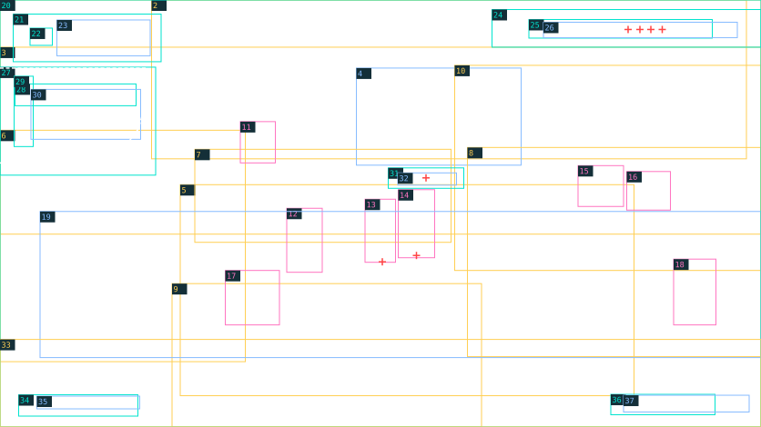

# World và HUD — layout sheet

> Generated by tools/coastal_reference_specs.py; edit layouts.json / fixtures.json.



1672 × 941; x/y from top-left; bounding envelopes ±4 px for rectangular regions, ±12 px for organic silhouettes. These are placement seeds; final masks and type matching remain production work.

Yellow: reconstruct · cyan: vector/mask · pink: new pose · blue: text · red cross: anchor · white dashed: sampled contour.

| # | ID / role | x, y, w, h | z | Method | Asset / planned text group | Occlusion / production note |
| --- | --- | --- | --- | --- | --- | --- |
| 1 | room-shell / Tường, sàn, cửa sổ và bố cục phòng | 0, 0, 1672, 941 | 10 | reconstruct | hud.room-shell | Cần geometry/world mapping; không ghép tất cả actor/props vào nền. |
| 2 | harbor-windows / Cảnh cảng qua ba cửa sổ | 333, 0, 1307, 350 | 11 | reconstruct | hud.harbor-windows | Phục dựng phía sau khung/props; ánh sáng biển. |
| 3 | wall-props / Bảng, đồng hồ, tranh báo và poster | 0, 104, 1672, 412 | 20 | reconstruct | hud.wall-props | Tách các mặt chứa chữ khỏi plate. |
| 4 | wall-lettering / Tên CLB và slogan trên tường | 783, 150, 362, 214 | 21 | text | hud.scene-signs | Nội dung bảng/áp phích; thêm planes nhỏ từ inventory. |
| 5 | floor-sun / Ánh nắng và bóng trên sàn | 396, 407, 997, 465 | 25 | reconstruct | hud.floor-sun | Mask lighting theo props; không bake actor shadows. |
| 6 | left-storage / Tủ, hộp, máy in và báo phía trái | 0, 287, 539, 510 | 30 | reconstruct | hud.left-storage | Phân occluders ở x=0–539. |
| 7 | rear-desk / Bàn phía sau và props | 428, 329, 563, 205 | 31 | reconstruct | hud.rear-desk | Actor ngồi sau bàn; props che thân dưới. |
| 8 | right-desks / Cụm bàn phía phải | 1027, 325, 645, 461 | 32 | reconstruct | hud.right-desks | Có hai depth bands, không flat background. |
| 9 | front-desk / Bàn tiền cảnh giữa | 378, 625, 680, 316 | 60 | reconstruct | hud.front-desk | Occlude actor phía sau; cần phân chân/mặt bàn. |
| 10 | plants-shelves / Cây, sách, kệ và quả địa cầu | 999, 144, 673, 452 | 33 | reconstruct | hud.plants-shelves | Props nhóm theo depth; giữ từng cây quan trọng để motion sau. |
| 11 | actor-rear-writer / Actor rear-writer | 528, 268, 77, 91 | 29 | new-pose | hud.actor-rear-writer | Reference sprite/chibi style; actor source in R32, scene pose/depth in R33, idle/talk/walk in R35. |
| 12 | actor-reader-left / Actor reader-left | 630, 459, 78, 141 | 42 | new-pose | hud.actor-reader-left | Reference sprite/chibi style; actor source in R32, scene pose/depth in R33, idle/talk/walk in R35. |
| 13 | actor-khue / Actor khue | 802, 439, 67, 139 | 43 | new-pose | hud.actor-khue | Reference sprite/chibi style; actor source in R32, scene pose/depth in R33, idle/talk/walk in R35. |
| 14 | actor-van / Actor van | 875, 418, 80, 150 | 44 | new-pose | hud.actor-van | Reference sprite/chibi style; actor source in R32, scene pose/depth in R33, idle/talk/walk in R35. |
| 15 | actor-right-left / Actor right-left | 1270, 365, 100, 90 | 31 | new-pose | hud.actor-right-left | Reference sprite/chibi style; actor source in R32, scene pose/depth in R33, idle/talk/walk in R35. |
| 16 | actor-right-right / Actor right-right | 1377, 378, 96, 85 | 31 | new-pose | hud.actor-right-right | Reference sprite/chibi style; actor source in R32, scene pose/depth in R33, idle/talk/walk in R35. |
| 17 | actor-front-writer / Actor front-writer | 495, 596, 119, 120 | 55 | new-pose | hud.actor-front-writer | Reference sprite/chibi style; actor source in R32, scene pose/depth in R33, idle/talk/walk in R35. |
| 18 | actor-right-front / Actor right-front | 1480, 571, 93, 145 | 48 | new-pose | hud.actor-right-front | Reference sprite/chibi style; actor source in R32, scene pose/depth in R33, idle/talk/walk in R35. |
| 19 | scene-small-copy / Nhãn tòa soạn, bản thảo, báo/sổ nhỏ | 88, 466, 1584, 322 | 49 | text | hud.small-signs | Nhiều plane; chỉ chữ xác minh được là canonical. |
| 20 | edge-waves / Mực viền góc trái/phải và đáy | 0, 0, 1672, 941 | 70 | vector-mask | hud.edge-waves | Chỉ edge masks, không fill toàn màn. |
| 21 | date-paper / Date seal giấy | 29, 31, 325, 105 | 75 | vector-mask | hud.date-paper | Lỗ/mép giấy; không card chuẩn. |
| 22 | date-mark / Mark date | 66, 62, 49, 38 | 76 | vector-mask | shared.brand-mark | Mark biến thể trên date seal. |
| 23 | date-copy / Ngày và phase | 125, 44, 205, 79 | 77 | text | hud.date | Hai baseline. |
| 24 | resource-ribbon / Dải tài nguyên phải trên | 1081, 21, 591, 83 | 75 | vector-mask | hud.resource-ribbon | Brush silhouette, không thanh ở ngoài world. |
| 25 | resource-icons / Lightning, coin, 4 chấm và rule | 1162, 43, 403, 41 | 76 | vector-mask | hud.resource-icons |  |
| 26 | resource-copy / Năng lượng 3/4 và 450đ | 1194, 49, 426, 34 | 77 | text | hud.resources | Hai nhóm text. |
| 27 | objective-surface / Mực mục tiêu bên trái | 0, 148, 342, 238 | 75 | vector-mask | hud.objective-surface | Mép lượn và vệt vàng; ôm cạnh trái. |
| 28 | objective-highlight / Vệt vàng title | 33, 185, 266, 48 | 76 | vector-mask | hud.objective-highlight |  |
| 29 | objective-spine / Trục/chấm và bullet | 31, 168, 42, 155 | 77 | vector-mask | hud.objective-spine |  |
| 30 | objective-copy / Đang theo dõi + nội dung | 68, 197, 241, 110 | 78 | text | hud.objective | Headline và hai dòng mô tả. |
| 31 | interaction-paper / Prompt vàng trên actor | 853, 370, 166, 45 | 80 | vector-mask | hud.interaction-paper |  |
| 32 | interaction-copy / E · Trò chuyện | 874, 381, 129, 27 | 81 | text | hud.interaction | Đặt ở vị trí relative actor trong world tương lai. |
| 33 | foreground-plants / Cây mờ và báo mép đáy | 0, 748, 1672, 193 | 85 | reconstruct | hud.foreground-plants | Foreground depth và blur riêng. |
| 34 | location-mark-rule / Pin và rule location | 41, 870, 262, 47 | 90 | vector-mask | hud.location-mark-rule |  |
| 35 | location-copy / Tòa soạn Hồi Âm | 81, 873, 226, 28 | 91 | text | hud.location | Chữ sáng. |
| 36 | controls-icons / Map icon, separator và Esc keycap | 1342, 869, 229, 45 | 90 | vector-mask | hud.controls-icons |  |
| 37 | controls-copy / M · Bản đồ / Esc · Menu | 1370, 871, 276, 37 | 91 | text | hud.controls | Không dấu hướng dẫn WASD dài giữa scene. |

## Anchors and contours

```json
{
  "anchors": [
    {
      "id": "player-feet",
      "point": [
        840,
        577
      ]
    },
    {
      "id": "van-feet",
      "point": [
        915,
        563
      ]
    },
    {
      "id": "prompt-center",
      "point": [
        936,
        392
      ]
    },
    {
      "id": "energy-dot-centers",
      "points": [
        [
          1380,
          65
        ],
        [
          1406,
          65
        ],
        [
          1430,
          65
        ],
        [
          1455,
          65
        ]
      ]
    }
  ],
  "contours": [
    {
      "id": "objective-edge",
      "layer": "objective-surface",
      "kind": "visible-sampled-polyline",
      "points": [
        [
          0,
          150
        ],
        [
          320,
          150
        ],
        [
          324,
          213
        ],
        [
          304,
          284
        ],
        [
          280,
          316
        ],
        [
          195,
          342
        ],
        [
          117,
          343
        ],
        [
          42,
          362
        ],
        [
          0,
          359
        ]
      ]
    }
  ]
}
```

## Lighting / protected reading zones

```json
{
  "key": "daylight through windows toward lower-right floor",
  "rim": "window-side actor edges",
  "shadows": "diagonal cast shadows and desk contact",
  "focus": "walkable foreground middle with HUD framing",
  "protected": [
    "objective-copy",
    "resource-copy",
    "interaction-copy"
  ]
}
```

## Typography and fixture text

Font sizes are estimates. Typeface, weight, exact baseline, kerning and rotation require R07 native-scale review. Planned keys belong to this authoring fixture until adopted by the live catalog.

| Group | Planned key | Text | Role / estimated px | Transcription status |
| --- | --- | --- | --- | --- |
| hud.scene-signs | ui.replica.hud.scene_signs.1 | CLB BÁO CHÍ | editorial-serif / 27 | transcribed-visible |
| hud.scene-signs | ui.replica.hud.scene_signs.2 | HỒI ÂM | editorial-serif / 27 | transcribed-visible |
| hud.scene-signs | ui.replica.hud.scene_signs.3 | Viết<br>Quan sát<br>Lắng nghe<br>Kết nối | editorial-serif / 27 | transcribed-visible |
| hud.small-signs | ui.replica.hud.small_signs.1 | TÒA SOẠN | handwriting / 20 | major-labels-transcribed-microcopy-pending |
| hud.small-signs | ui.replica.hud.small_signs.2 | BẢN THẢO | handwriting / 20 | major-labels-transcribed-microcopy-pending |
| hud.small-signs | ui.replica.hud.small_signs.3 | Số 02: Sân bóng | handwriting / 20 | major-labels-transcribed-microcopy-pending |
| hud.small-signs | ui.replica.hud.small_signs.4 | Phỏng vấn | handwriting / 20 | major-labels-transcribed-microcopy-pending |
| hud.small-signs | ui.replica.hud.small_signs.5 | Ảnh tư liệu | handwriting / 20 | major-labels-transcribed-microcopy-pending |
| hud.small-signs | ui.replica.hud.small_signs.6 | Bố cục | handwriting / 20 | major-labels-transcribed-microcopy-pending |
| hud.small-signs | ui.replica.hud.small_signs.7 | Duyệt lần cuối | handwriting / 20 | major-labels-transcribed-microcopy-pending |
| hud.date | ui.replica.hud.date.1 | THỨ NĂM | editorial-serif / 34 | transcribed-visible |
| hud.date | ui.replica.hud.date.2 | Chiều · Phòng CLB | editorial-serif / 34 | transcribed-visible |
| hud.resources | ui.replica.hud.resources.1 | Năng lượng 3 / 4 | editorial-serif / 24 | transcribed-visible |
| hud.resources | ui.replica.hud.resources.2 | 450đ | editorial-serif / 24 | transcribed-visible |
| hud.objective | ui.replica.hud.objective.1 | ĐANG THEO DÕI | editorial-serif / 25 | transcribed-visible |
| hud.objective | ui.replica.hud.objective.2 | Trao đổi với Vân<br>về bản thảo. | editorial-serif / 25 | transcribed-visible |
| hud.interaction | ui.replica.hud.interaction.1 | E · Trò chuyện | sans / 22 | transcribed-visible |
| hud.location | ui.replica.hud.location.1 | TÒA SOẠN HỒI ÂM | editorial-serif / 24 | transcribed-visible |
| hud.controls | ui.replica.hud.controls.1 | M · Bản đồ | editorial-serif / 21 | transcribed-visible |
| hud.controls | ui.replica.hud.controls.2 | Esc | editorial-serif / 21 | transcribed-visible |
| hud.controls | ui.replica.hud.controls.3 | · Menu | editorial-serif / 21 | transcribed-visible |

Không đồng nhất screen pixels với tile collision; R31 cần world mapping riêng.
Bảng chữ nhỏ có generated microtext; cần canonical transcription/content ở production.
