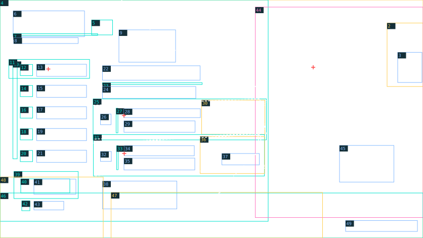

# Menu — layout sheet

> Generated by tools/coastal_reference_specs.py; edit layouts.json / fixtures.json.



1672 × 941; x/y from top-left; bounding envelopes ±4 px for rectangular regions, ±12 px for organic silhouettes. These are placement seeds; final masks and type matching remain production work.

Yellow: reconstruct · cyan: vector/mask · pink: new pose · blue: text · red cross: anchor · white dashed: sampled contour.

| # | ID / role | x, y, w, h | z | Method | Asset / planned text group | Occlusion / production note |
| --- | --- | --- | --- | --- | --- | --- |
| 1 | harbor-room / Cảng, cửa sổ, cây và tòa soạn | 0, 0, 1672, 941 | 10 | reconstruct | menu.harbor-room | Plate đầy đủ sau nhân vật và xanh mực. |
| 2 | wall-poster / Poster bên phải và mark | 1530, 91, 142, 251 | 12 | reconstruct | menu.wall-poster | Nền giấy không chữ; các chữ dựng riêng. |
| 3 | wall-poster-copy / Chữ poster | 1572, 207, 96, 119 | 13 | text | menu.scene-signs | Theo perspective bề mặt. |
| 4 | teal-mass / Mảng mực xanh toàn trái | 0, 0, 1060, 875 | 20 | vector-mask | menu.teal-mass | Silhouette hữu cơ và texture, không panel chữ nhật. |
| 5 | brand-mark / Mark title | 362, 79, 83, 59 | 25 | vector-mask | shared.brand-mark | Vector master có variant. |
| 6 | brand-title / HỒI ÂM | 52, 43, 282, 102 | 26 | text | menu.brand | Serif sáng; baseline khoảng 126. |
| 7 | brand-rule / Kẻ dưới thương hiệu | 52, 133, 334, 7 | 25 | vector-mask | menu.brand-rule |  |
| 8 | week-label / Thành phố / tuần | 54, 149, 255, 23 | 26 | text | menu.week | Tracking rộng. |
| 9 | brand-tagline / Câu viết tay ở phía trên | 470, 118, 224, 128 | 26 | text | menu.tagline | Chữ viết tay ba dòng; theo góc giấy/mực. |
| 10 | nav-spine / Trục dọc và chấm navigation | 51, 243, 17, 385 | 30 | vector-mask | menu.nav-spine |  |
| 11 | nav-highlight / Vệt cọ vàng mục chọn | 35, 235, 319, 75 | 31 | vector-mask | menu.nav-highlight | Sơn vàng có grain và đầu xước. |
| 12 | nav-cases-icon / Hồ sơ: icon | 80, 255, 49, 44 | 32 | vector-mask | menu.nav-cases-icon |  |
| 13 | nav-cases-copy / Hồ sơ: nhãn | 145, 254, 197, 48 | 33 | text | menu.nav-cases | Chữ uppercase serif. |
| 14 | nav-team-icon / Đồng đội: icon | 80, 338, 49, 44 | 32 | vector-mask | menu.nav-team-icon |  |
| 15 | nav-team-copy / Đồng đội: nhãn | 145, 337, 197, 48 | 33 | text | menu.nav-team | Chữ uppercase serif. |
| 16 | nav-calendar-icon / Lịch: icon | 80, 423, 49, 44 | 32 | vector-mask | menu.nav-calendar-icon |  |
| 17 | nav-calendar-copy / Lịch: nhãn | 145, 422, 197, 48 | 33 | text | menu.nav-calendar | Chữ uppercase serif. |
| 18 | nav-journal-icon / Nhật ký: icon | 80, 509, 49, 44 | 32 | vector-mask | menu.nav-journal-icon |  |
| 19 | nav-journal-copy / Nhật ký: nhãn | 145, 508, 197, 48 | 33 | text | menu.nav-journal | Chữ uppercase serif. |
| 20 | nav-settings-icon / Thiết lập: icon | 80, 595, 49, 44 | 32 | vector-mask | menu.nav-settings-icon |  |
| 21 | nav-settings-copy / Thiết lập: nhãn | 145, 594, 197, 48 | 33 | text | menu.nav-settings | Chữ uppercase serif. |
| 22 | section-heading / Hồ sơ đang mở | 405, 260, 386, 57 | 35 | text | menu.heading | Title riêng giữa screen, không heading menu. |
| 23 | section-rule / Kẻ dưới section | 405, 327, 394, 7 | 34 | vector-mask | menu.section-rule |  |
| 24 | section-intro / Mô tả section | 405, 342, 369, 47 | 35 | text | menu.intro | Hai dòng. |
| 25 | case-one-paper / Mẩu hồ sơ 01 | 368, 391, 685, 162 | 40 | vector-mask | menu.case-one-paper | Góc giấy theo quad; đục lỗ; không bake thumbnail/chữ. |
| 26 | case-one-number / Số 01 | 397, 451, 42, 42 | 42 | text | menu.case-one-number | Số italic cyan. |
| 27 | case-one-rule / Rule bên số 01 | 459, 428, 7, 97 | 41 | vector-mask | menu.case-one-rule |  |
| 28 | case-one-title / Title hồ sơ 01 | 490, 430, 302, 35 | 42 | text | menu.case-one-title | Upper/lower case theo ref. |
| 29 | case-one-teaser / Teaser hồ sơ 01 | 490, 478, 281, 45 | 42 | text | menu.case-one-teaser | Hai dòng. |
| 30 | case-one-thumb / Ảnh báo/tư liệu | 797, 396, 250, 135 | 41 | reconstruct | menu.case-one-thumb | Băng dính và phần text trong ảnh phải tách; không crop rồi giữ chữ. |
| 31 | case-two-paper / Mẩu hồ sơ 02 | 369, 532, 676, 164 | 40 | vector-mask | menu.case-two-paper |  |
| 32 | case-two-number / Số 02 | 397, 599, 43, 39 | 42 | text | menu.case-two-number | Số italic cyan. |
| 33 | case-two-rule / Rule bên số 02 | 461, 576, 6, 95 | 41 | vector-mask | menu.case-two-rule |  |
| 34 | case-two-title / Title hồ sơ 02 | 491, 576, 277, 40 | 42 | text | menu.case-two-title | Theo góc strip. |
| 35 | case-two-teaser / Teaser hồ sơ 02 | 490, 625, 280, 47 | 42 | text | menu.case-two-teaser | Hai dòng. |
| 36 | case-two-thumb / Ảnh cổng sân bóng | 791, 540, 255, 146 | 41 | reconstruct | menu.case-two-thumb | Nhãn cổng tách chữ riêng. |
| 37 | case-two-sign / Nhãn tạm đóng cửa | 877, 607, 148, 45 | 42 | text | menu.case-two-sign | Text trong thumbnail; transform theo phối cảnh. |
| 38 | lower-quote / Lời trích viết tay | 405, 716, 294, 110 | 43 | text | menu.quote | Ba dòng và marks. |
| 39 | resources-rules / Đường kẻ resource | 55, 678, 254, 107 | 45 | vector-mask | menu.resources-rules |  |
| 40 | energy-icon-dots / Lightning và energy dots | 82, 707, 194, 56 | 46 | vector-mask | menu.energy-icon-dots | 4 chấm: ba filled, một empty; fixture, không cap domain. |
| 41 | energy-copy / Label và số năng lượng | 134, 708, 166, 60 | 47 | text | menu.energy | Label nhỏ, số lớn. |
| 42 | money-icon / Icon tiền | 86, 794, 32, 39 | 46 | vector-mask | menu.money-icon |  |
| 43 | money-copy / 450đ | 134, 796, 118, 34 | 47 | text | menu.money | Fixture tài nguyên. |
| 44 | khue-notebook / Khuê cầm sổ, satchel | 1009, 28, 663, 832 | 50 | new-pose | menu.khue-notebook | Tay/sổ phải khớp; phần thân sau wave cần phục dựng. |
| 45 | notebook-lettering / Chữ/mark trên sổ | 1342, 575, 215, 145 | 51 | text | menu.notebook | Nghiêng theo sổ; mark graphic riêng. |
| 46 | bottom-wave / Viền sóng/mực và giấy đáy | 0, 763, 1672, 178 | 65 | vector-mask | menu.bottom-wave |  |
| 47 | foreground-paper / Báo tiền cảnh đáy giữa | 439, 761, 836, 180 | 70 | reconstruct | menu.foreground-paper | Blur tiền cảnh theo ref, không che controls. |
| 48 | foreground-flowers / Hoa/lá hai góc | 0, 700, 408, 241 | 71 | reconstruct | menu.foreground-flowers | Tiền cảnh bên trái; góc phải nằm chung plate cảng/props. |
| 49 | key-hints / Chọn / Esc trở lại | 1366, 872, 284, 43 | 75 | text | menu.controls | Glyph enter và keycap riêng. |

## Anchors and contours

```json
{
  "anchors": [
    {
      "id": "khue-eye",
      "point": [
        1238,
        266
      ],
      "note": "Left visible iris in screen coordinates; manual placement seed"
    },
    {
      "id": "nav-selected",
      "point": [
        191,
        273
      ]
    },
    {
      "id": "case-one-title-baseline",
      "point": [
        490,
        457
      ]
    },
    {
      "id": "case-two-title-baseline",
      "point": [
        491,
        607
      ]
    }
  ],
  "contours": [
    {
      "id": "teal-right-edge",
      "layer": "teal-mass",
      "kind": "visible-sampled-polyline",
      "points": [
        [
          480,
          0
        ],
        [
          580,
          104
        ],
        [
          660,
          181
        ],
        [
          796,
          256
        ],
        [
          928,
          302
        ],
        [
          1040,
          357
        ],
        [
          1058,
          390
        ],
        [
          1012,
          488
        ],
        [
          1028,
          592
        ],
        [
          922,
          696
        ],
        [
          870,
          761
        ],
        [
          760,
          810
        ],
        [
          663,
          864
        ]
      ],
      "note": "Mép một phần bị strip/portrait che; không alpha polygon hoàn chỉnh."
    },
    {
      "id": "case-one-quad",
      "layer": "case-one-paper",
      "kind": "quad",
      "points": [
        [
          368,
          416
        ],
        [
          1027,
          391
        ],
        [
          1052,
          528
        ],
        [
          369,
          550
        ]
      ]
    },
    {
      "id": "case-two-quad",
      "layer": "case-two-paper",
      "kind": "quad",
      "points": [
        [
          369,
          566
        ],
        [
          1028,
          532
        ],
        [
          1045,
          665
        ],
        [
          370,
          695
        ]
      ]
    }
  ]
}
```

## Lighting / protected reading zones

```json
{
  "key": "warm sun from upper-right harbor window",
  "rim": "hair/tie/notebook and shoulder",
  "shadows": "notebook hands/satchel, foreground newspaper",
  "protected": [
    "section-heading",
    "case-one-title",
    "case-two-title",
    "key-hints"
  ]
}
```

## Typography and fixture text

Font sizes are estimates. Typeface, weight, exact baseline, kerning and rotation require R07 native-scale review. Planned keys belong to this authoring fixture until adopted by the live catalog.

| Group | Planned key | Text | Role / estimated px | Transcription status |
| --- | --- | --- | --- | --- |
| menu.scene-signs | ui.replica.menu.scene_signs.1 | Viết<br>Quan sát<br>Lắng nghe<br>Kết nối | handwriting / 22 | transcribed-visible |
| menu.brand | ui.replica.menu.brand.1 | HỒI ÂM | editorial-serif / 92 | transcribed-visible |
| menu.week | ui.replica.menu.week.1 | Hải Vọng · Tuần 02 | editorial-serif / 22 | transcribed-visible |
| menu.tagline | ui.replica.menu.tagline.1 | Câu chuyện<br>Từ Hải Vọng<br>Đến mọi người | handwriting / 25 | transcribed-visible |
| menu.nav-cases | ui.replica.menu.nav_cases.1 | HỒ SƠ | editorial-serif / 35 | transcribed-visible |
| menu.nav-team | ui.replica.menu.nav_team.1 | ĐỒNG ĐỘI | editorial-serif / 35 | transcribed-visible |
| menu.nav-calendar | ui.replica.menu.nav_calendar.1 | LỊCH | editorial-serif / 35 | transcribed-visible |
| menu.nav-journal | ui.replica.menu.nav_journal.1 | NHẬT KÝ | editorial-serif / 35 | transcribed-visible |
| menu.nav-settings | ui.replica.menu.nav_settings.1 | THIẾT LẬP | editorial-serif / 35 | transcribed-visible |
| menu.heading | ui.replica.menu.heading.1 | Hồ sơ đang mở | editorial-serif / 54 | transcribed-visible |
| menu.intro | ui.replica.menu.intro.1 | Những manh mối, con người và câu chuyện<br>đang chờ được viết tiếp. | editorial-serif / 19 | transcribed-visible |
| menu.case-one-number | ui.replica.menu.case_one_number.1 | 01 | italic-serif / 38 | transcribed-visible |
| menu.case-one-title | ui.replica.menu.case_one_title.1 | Khoản thu câu lạc bộ | editorial-serif / 28 | transcribed-visible |
| menu.case-one-teaser | ui.replica.menu.case_one_teaser.1 | Những con số, những câu hỏi,<br>và một buổi họp còn nhiều điều bỏ ngỏ. | editorial-serif / 18 | transcribed-visible |
| menu.case-two-number | ui.replica.menu.case_two_number.1 | 02 | italic-serif / 38 | transcribed-visible |
| menu.case-two-title | ui.replica.menu.case_two_title.1 | Sân bóng đóng cửa | editorial-serif / 29 | transcribed-visible |
| menu.case-two-teaser | ui.replica.menu.case_two_teaser.1 | Vì sao sân bóng của trường<br>bất ngờ tạm ngừng hoạt động? | editorial-serif / 18 | transcribed-visible |
| menu.case-two-sign | ui.replica.menu.case_two_sign.1 | TẠM ĐÓNG CỬA | sans-condensed / 20 | transcribed-visible |
| menu.quote | ui.replica.menu.quote.1 | “Có những chuyện<br>chỉ thật sự bắt đầu<br>khi ta chịu lắng nghe.” | handwriting / 25 | transcribed-visible |
| menu.energy | ui.replica.menu.energy.1 | Năng lượng | editorial-serif / 22 | transcribed-visible |
| menu.energy | ui.replica.menu.energy.2 | 3/4 | editorial-serif / 22 | transcribed-visible |
| menu.money | ui.replica.menu.money.1 | 450đ | editorial-serif / 30 | transcribed-visible |
| menu.notebook | ui.replica.menu.notebook.1 | CLB BÁO CHÍ | editorial-serif / 22 | headline-transcribed-microcopy-pending |
| menu.controls | ui.replica.menu.controls.1 | ↵ | editorial-serif / 21 | transcribed-visible |
| menu.controls | ui.replica.menu.controls.2 | Chọn | editorial-serif / 21 | transcribed-visible |
| menu.controls | ui.replica.menu.controls.3 | Esc | editorial-serif / 21 | transcribed-visible |
| menu.controls | ui.replica.menu.controls.4 | Trở lại | editorial-serif / 21 | transcribed-visible |

Nền xanh là mask hữu cơ có grain; navigation không nằm trong tờ giấy.
Text nhỏ trên notebook/thumbnail cần riêng layer plane và catalog.
